# 2. Жизненный цикл запроса: от SQL до распределённого плана

Код: `core/trino-parser`, `core/trino-main/src/main/java/io/trino/sql/**`, `io.trino.execution`,
`io.trino.execution.scheduler`. Оркестратор — `.../execution/SqlQueryExecution.java`:
`start()` → `transitionToPlanning` → `planQuery` (LogicalPlanner + PlanFragmenter) →
`planDistribution` (создание `QueryScheduler`) → `transitionToStarting` → `scheduler.start()`.

## 2.1. Общая цепочка компиляции

```mermaid
flowchart LR
    SQL["SQL-текст"] --> P["SqlParser<br/>(ANTLR, SqlBase.g4)"]
    P --> AST["AST: io.trino.sql.tree"]
    AST --> A["Analyzer / StatementAnalyzer<br/>(Scope, Field, ResolvedFunction)"]
    A --> AN["Analysis"]
    AN --> LP["LogicalPlanner<br/>(RelationPlanner, QueryPlanner, SubqueryPlanner)"]
    LP --> PLAN["Дерево PlanNode"]
    PLAN --> OPT["PlanOptimizers:<br/>batch + IterativeOptimizer (rules)<br/>+ StatsCalculator/CostCalculator"]
    OPT --> FRAG["PlanFragmenter<br/>(резка по REMOTE ExchangeNode → SubPlan/PlanFragment)"]
    FRAG --> SCHED["PipelinedQueryScheduler<br/>(SqlStage, NodeScheduler, splits)"]
    SCHED --> WORKER["Воркеры:<br/>LocalExecutionPlanner → DriverFactory → операторы"]
```

## 2.2. Парсинг

- Грамматика: `core/trino-grammar/src/main/antlr4/io/trino/grammar/sql/SqlBase.g4`.
- `.../sql/parser/SqlParser.java`: двухфазный разбор — быстрый `PredictionMode.SLL` + `BailErrorStrategy`, при неудаче повтор в `PredictionMode.LL` с `NonRecoveringErrorStrategy`; `PostProcessor` переписывает nonReserved-токены в IDENTIFIER; `AstBuilder` строит AST (`io.trino.sql.tree`, ~300 классов).
- В planner'е выражения переводятся в row-level IR `io.trino.sql.ir` (`Reference`, `FieldReference`, `Call`, `Cast`, `Constant`, `Lambda`, ...).

## 2.3. Анализ

`.../sql/analyzer/`:
1. `StatementRewrite.rewrite` (раскрытие views и др.);
2. `StatementAnalyzer` строит `Scope`-и (`RelationType` из `Field`), проверяет GROUP BY/window/order-by, pattern recognition, анализирует DML;
3. `ExpressionAnalyzer`/`TypeAnalyzer` вычисляют типы; функции резолвятся через `io.trino.metadata.FunctionResolver` → `ResolvedFunction`;
4. Access control: `checkCanSelectFromColumns` по `analysis.getTableColumnReferences()`.

`Analysis` хранит: scopes, resolved функции, `TableHandle`/`ColumnHandle` для таблиц и INSERT/CREATE, named queries (views), column references. **Здесь впервые вызывается коннектор** — `Metadata.getTableHandle(session, tableName)` (для Iceberg — `IcebergMetadata.getTableHandle`, см. [07](07-iceberg-metadata-transactions.md)).

## 2.4. Логическое планирование

`.../sql/planner/LogicalPlanner.java` — `plan(analysis, stage, collectPlanStatistics)`:
- `planStatement` диспетчеризует по типу statement:
  - `Query` → `RelationPlanner` (FROM/WHERE/GROUP BY/HAVING/SELECT/window/ORDER);
  - `Insert`/`RefreshMaterializedView` → cast'ы «no truncation» → `createTableWriterPlan` (`TableWriterNode` внутри `TableFinishNode`, опциональная partitioned write и частичная агрегация статистик);
  - `Delete`/`Update`/`merge` → `QueryPlanner.plan`, корень приводится к `MergeWriterNode` + `MergeProcessorNode` + `TableFinishNode` — **DELETE/UPDATE/MERGE в Trino реализуются через merge-механику** (для Iceberg это ключевой путь — см. [09](09-iceberg-write-path.md)); `TableDeleteNode`/`TableUpdateNode` существуют для connector pushdown (у Iceberg — metadata-only DELETE);
  - `TableExecute` (OPTIMIZE и др.) → `createTableExecutePlan`.
- затем `PlanSanityChecker.validateIntermediatePlan`, прогон оптимизаторов, `validateFinalPlan`, сбор `StatsAndCosts`.

Основные план-узлы (`io.trino.sql.planner.plan`): `OutputNode`, `ProjectNode`, `FilterNode`,
`JoinNode` (типы INNER/LEFT/RIGHT/FULL; `DistributionType` PARTITIONED/REPLICATED), `AggregationNode`
(Step: PARTIAL/FINAL/SINGLE), `ExchangeNode` (Type: GATHER/REPARTITION/REPLICATE; Scope: LOCAL/REMOTE),
`TableScanNode` (TableHandle, assignments ColumnHandle, enforced TupleDomain),
`TableWriterNode`/`TableFinishNode`, `MergeWriterNode`/`MergeProcessorNode`, `SemiJoinNode`,
`WindowNode`, `SortNode`, `TopNNode`, `LimitNode`, `UnnestNode`, `SetOperationNode`,
`RemoteSourceNode`, `DynamicFilterSourceNode`, `StatisticsWriterNode`, `ValuesNode`, ...

`Symbol` — `record Symbol(Type type, String name)` — тип встроен в символ.

## 2.5. Оптимизация

### Rule-фреймворк

- `lib/trino-matching` — `Pattern<T>`, `Capture`, `PropertyPattern`;
- `.../sql/planner/iterative/IterativeOptimizer.java` — строит `Memo` (группы эквивалентных планов), индексирует правила (`RuleIndex`), цикл `exploreGroup → exploreNode → exploreChildren`; таймаут `optimizer_timeout`; статистика правил `PlanOptimizersStatsCollector`;
- `Rule<T>` — `getPattern()` + `apply(node, captures, context)`.

### Конвейер оптимизаторов (`.../sql/planner/PlanOptimizers.java`, ~1160 строк)

Основные фазы (имена `IterativeOptimizer`-ов, порядок важен):
1. **DesugarLambdaExpressions**, **InitialPlanCleanup** (column pruning ~50 правил `Prune*Columns` + projection pushdown + simplify);
2. limit pushdown, merge limit/sort/topN, `UnaliasSymbolReferences`, **MergeSetOperations**, **ImplementSetOperationsAsUnion**;
3. декорреляция подзапросов: **DecorrelateSubqueries** (`TransformUncorrelatedSubqueryToJoin`, `TransformUncorrelatedInPredicateSubqueryToSemiJoin`, ...), **RewriteCorrelatedSubqueries**, `CheckSubqueryNodesAreRewritten`;
4. **PredicatePushDown** (несколько прогонов, включая dynamic filters);
5. **PushIntoTableScan** — собственно pushdown в коннектор (`Metadata.applyFilter` / `applyProjection`) — критично для Iceberg (partition pruning);
6. **OptimizeDistinctAggregations**, window pushdown/merge, `MetadataQueryOptimizer` (min/max/distinct по партициям → `ValuesNode`, важно для Iceberg благодаря discrete predicates);
7. **EliminateCrossJoins**, **ReorderJoins** (до 63 источников в `MultiJoinNode`, стратегия `join_reordering_strategy=AUTOMATIC`);
8. **OptimizeWritesAndScanPartitioning** (`DetermineTableScanNodePartitioning`, `PushMergeWriterDeleteIntoConnector`, `OptimizeDuplicateInsensitiveJoins`);
9. **DetermineJoinDistributions** (`DetermineJoinDistributionType`, `DetermineSemiJoinDistributionType` — cost-based выбор broadcast/partitioned);
10. **AddExchanges** — центральный распределённый оптимизатор: решает, где нужны REMOTE exchange, выбирает partitioning, режет агрегации на partial/final, sort на partial+merging, включает `redistributeWrites`/`scaleWriters`;
11. **DeterminePartitionCount**, `AddLocalExchanges` (согласование параллелизма внутри задачи), `OptimizeLocalExchangeConsumers`, **PushPartialAggregations**, `AddIntermediateAggregations`, **AddDynamicFilterSources**.

### Стоимость и статистики

`io.trino.cost`:
- `StatsCalculator` (композит правил `*StatsRule`) → `PlanNodeStatsEstimate` (row count + per-symbol `SymbolStatsEstimate`: nullsFraction, distinctValuesCount, ranges);
- `CostCalculatorWithEstimatedExchanges` (до AddExchanges) / `CostCalculatorUsingExchanges` — `PlanCostEstimate` (cpu, memory, network); `CostComparator` — линейная свёртка с весами `optimizer.*-cost-weight`;
- источники — `Metadata.getTableStatistics` (для Iceberg — [10](10-iceberg-statistics-optimization.md)).

## 2.6. Partitioning-модель

- `PartitioningHandle` = (catalogHandle, transactionHandle, `ConnectorPartitioningHandle`, scaledWriters). Коннектор может дать свой handle — у Iceberg это `IcebergPartitioningHandle` (bucket execution);
- `SystemPartitioningHandle`: `SystemPartitioning {SINGLE, FIXED, SOURCE, COORDINATOR_ONLY, ARBITRARY}`; константы `SINGLE_DISTRIBUTION`, `FIXED_HASH_DISTRIBUTION`, `FIXED_BROADCAST_DISTRIBUTION`, `SOURCE_DISTRIBUTION`, `SCALED_WRITER_*`;
- `PartitioningScheme` (partitioning + outputLayout + bucketToPartition + partitionCount);
- bucket-функции: `SingleBucketFunction`, `HashBucketFunction`, `RoundRobinBucketFunction`.

## 2.7. PlanFragmenter: нарезка на фрагменты

`.../sql/planner/PlanFragmenter.java` — `createSubPlans(...)`:
- план режется **только по `ExchangeNode` со scope REMOTE**: GATHER → consumer получает single-node distribution; REPARTITION → `setDistribution(handle, partitionCount)`; exchange заменяется на `RemoteSourceNode`;
- `FragmentProperties` собирает требования: `setSingleNodeDistribution`, `setCoordinatorOnlyDistribution` (для `TableFinishNode`, `StatisticsWriterNode`, `TableDeleteNode`...), `addSourceDistribution` (для `TableScanNode` — из `Metadata.getTableProperties(...).getTablePartitioning()`), `setDistribution` для writer-узлов; несовместимые handle объединяются через `Metadata.getCommonPartitioning`;
- `PartitioningHandleReassigner` — «вталкивание» коннекторного partitioning в TableScan (co-located join'ы, важно для Iceberg bucket execution);
- результат: дерево `SubPlan` с `PlanFragment` (id, root, partitioning, `partitionedSources` — порядок из `SchedulingOrderVisitor.scheduleOrder(root)` — build-side-first обход, outputPartitioningScheme, StatsAndCosts);
- лимит `query_max_stage_count` → `QUERY_HAS_TOO_MANY_STAGES`.

## 2.8. Шедулирование

`io.trino.execution.scheduler`:

- `QueryScheduler` (interface): **`PipelinedQueryScheduler`** (retry policy QUERY/NONE — обычный режим) и `EventDrivenFaultTolerantQueryScheduler` (retry policy TASK, fault-tolerant execution с `AdaptivePlanner` и exchange manager);
- `PipelinedQueryScheduler`:
  - `CoordinatorStagesScheduler` — координаторные стадии (output, TableFinish, StatisticsWriter): по одной задаче на координаторе;
  - `DistributedStagesScheduler` — цикл `schedule()`: `ExecutionPolicy` (`AllAtOnceExecutionPolicy` / `PhasedExecutionPolicy` — по умолчанию phased) отдаёт готовые стадии; каждая — `SqlStage` + `PipelinedStageExecution`;
  - `NodePartitioningManager.getNodePartitioningMap` → `NodePartitionMap` (partitionToNode, bucketToPartition);
  - `createStageScheduler`: `SOURCE_DISTRIBUTION` → `SourcePartitionedScheduler` (динамическое размещение сплитов через `SplitSource` коннектора — у Iceberg `IcebergSplitSource`); writer-стадии → `ScaledWriterScheduler`; фиксированные стадии → `FixedCountScheduler`;
- `NodeScheduler`/`UniformNodeSelector` (или `TopologyAwareNodeSelector`): выбор нод для сплитов — кандидаты по locality (address split'а), otherwise `min-candidates` случайных нод; выбор — min queued splits weight; back-pressure при переполнении (`node-scheduler.max-splits-per-node=256`, `min-pending-splits-per-task=16`);
- задачи создаются через `HttpRemoteTaskFactory` → `POST /v1/task/{taskId}` с `TaskUpdateRequest` (plan fragment, split assignments, output buffers, session representation, dynamic filter domains).

## 2.9. Локальное планирование на воркере

`.../execution/SqlTaskExecutionFactory.java` → `.../sql/planner/LocalExecutionPlanner.java` (~4480 строк):
- первый проход: output factory — `TaskOutputFactory` (gather/single) или `PartitionedOutputFactory` (`PartitionFunction` + `PagePartitioner`, опциональный `SkewedPartitionRebalancer`);
- второй проход: `Visitor.visitXxx` для каждого PlanNode строит `PhysicalOperation` (operator factory + layout); контекст собирает пайплайны `DriverFactory`;
  - `visitTableScan` → `ConnectorPageSource` (через `PageSourceProvider` коннектора);
  - `visitScanFilterAndProject` — fusable scan+filter+project (`ScanFilterAndProjectOperator`);
  - `visitAggregation` → `HashAggregationOperator` (partial/final/single);
  - `visitJoin` → lookup-join операторы + dynamic filters (см. [04-joins.md](04-joins.md));
  - `visitRemoteSource` → `ExchangeOperator` с `DirectExchangeClient`;
  - `visitTableWriter`/`visitMergeWriter`/`visitTableFinish`/`visitStatisticsWriter` — путь записи (см. [09](09-iceberg-write-path.md));
- результат — `LocalExecutionPlan(List<DriverFactory>, partitionedSourceOrder)`; исполнение — `SqlTaskExecution` на `TaskExecutor` (см. [03-execution-runtime.md](03-execution-runtime.md)).

## 2.10. Доставка результата клиенту

- воркеры отдают страницы через `OutputBuffer` (`TaskOutputOperator`/`PartitionedOutputOperator`);
- downstream-задачи тянут их `ExchangeOperator` + `DirectExchangeClient` (`GET /v1/task/{taskId}/results/{bufferId}/{token}` + acknowledge);
- координатор читает output-стадию через `io.trino.exchange.DirectExchangeDataSource`, `io.trino.server.protocol.Query` формирует `QueryResults` (токенизированный nextUri, кеш повторных токенов), `ExecutingStatementResource` отдаёт JSON (или spooling/binary протокол).
