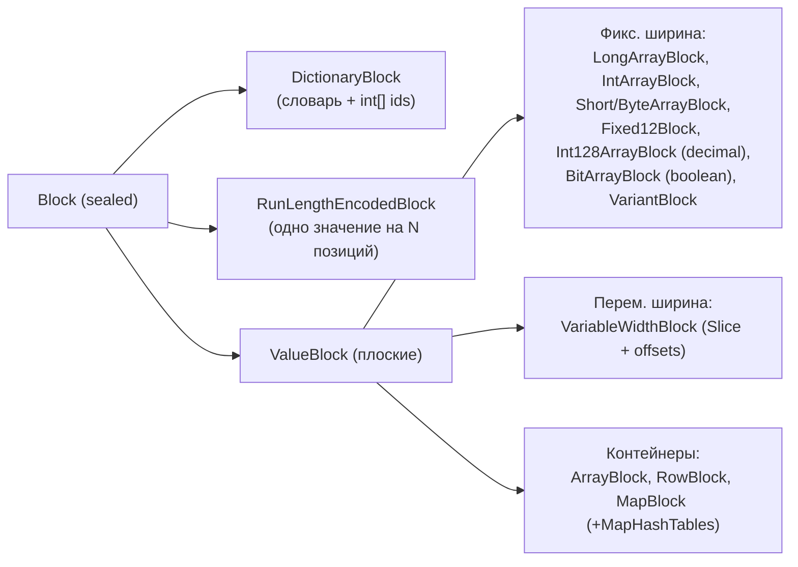

# 3. Рантайм выполнения: данные, операторы, память, exchange

Код: `core/trino-spi/src/main/java/io/trino/spi/{block,type,Page.java}`,
`core/trino-main/src/main/java/io/trino/{operator,execution,memory,exchange,spiller,sql/gen}`.

Trino — пайплайновая векторизованная система: данные движутся между операторами страницами
(`Page`) по колонкам (`Block`), выполнение — драйверы (`Driver`) на `TaskExecutor`,
между стадиями — HTTP-exchange сериализованными страницами, при нехватке памяти — spilling.

## 3.1. Page и Block

### Page
`core/trino-spi/.../Page.java` — `final` класс: `Block[] blocks` + `int positionCount`; ленивые `sizeInBytes`/`retainedSizeInBytes`. Методы: `getRegion`, `getColumns`, `getPositions` (через `DictionaryBlock`), `compact`. Page — единица передачи между всеми операторами и между задачами.

### Block — sealed-иерархия

`io.trino.spi.block.Block` — **sealed interface** ровно с тремя ветками:



Ключевые методы `Block`: `getPositionCount`, `getSizeInBytes` (оценка «как если бы развёрнут»), `getRetainedSizeInBytes` (реальная память, вызывается из горячего цикла), `getPositions/copyPositions/getRegion`, `isNull/mayHaveNull`, `getUnderlyingValueBlock/Position` (разворачивание обёрток).

Особенности этой версии (важно при чтении старых материалов):
- **`LazyBlock` удалён** (release 475) — ленивость осталась только в connector `PageSource`;
- null-валидность — битовые карты `long[]` (класс `io.trino.spi.block.Bitmap`, set bit = valid), согласовано с Java Vector API (SIMD);
- `BlockBuilder` — сборка (`append(ValueBlock, position)`, `appendNull`, `build()` — может вернуть RLE, если все значения одинаковы); сериализация — `BlockEncodingSerde` (+`BlockEncodingManager` в trino-main).

### Типы и TypeOperators

`io.trino.spi.type.Type`: `getJavaType()` (boolean/long/double/Object), `getValueBlockType()`, `isComparable/isOrderable`, `createBlockBuilder`, `getObjectValue`.

Сравнения/хэши — центральный класс `io.trino.spi.type.TypeOperators`: фабрика **MethodHandle**'ов с кэшем: `getEqualOperator`, `getHashCodeOperator`, `getOrderingOperator`, ... Каждый адаптируется под `InvocationConvention` (`BLOCK_POSITION`, `NEVER_NULL`, **`FLAT`** — «плоские» хэши для `FlatGroupByHash`, и т.д.). Контейнерные типы (Row/Array/Map) строят операторы рекурсивно из операторов полей. Встроенные операторы — `io.trino.type.*Operators`; менеджер типов — `io.trino.metadata.InternalTypeManager`.

Типы с точки зрения Iceberg: маппинг Iceberg-типов в Trino и обратно — в `.../iceberg/IcebergTypes.java` и `Types`-утилитах (timestamp с timezone, decimal (long/Int128), variant и т.д.).

## 3.2. Операторы и драйверы

### Operator
`io.trino.operator.Operator` — контракт жизненного цикла:
- `isBlocked()` (ListenableFuture), `needsInput()/addInput(Page)/getOutput()`;
- **память**: `startMemoryRevoke()/finishMemoryRevoke()` — отзыв памяти для spilling (после startMemoryRevoke драйвер не имеет права вызывать isBlocked/needsInput/addInput/getOutput до finishMemoryRevoke);
- `finish()/isFinished()/close()`.

`OperatorFactory.duplicate()` — фабрика клонируется на каждый драйвер. `SourceOperator` — расширение с `addSplit(Split)/noMoreSplits()` (сюда коннектор кладёт `IcebergSplit`).

Новая парадигма — **WorkProcessor-операторы**: `WorkProcessorOperator` (pull-модель, `WorkProcessor<T>` с `transform/flatTransform/blocking/yielding` + кооперативный yield) + адаптеры. Большинство современных операторов внутренне WorkProcessor.

Примеры операторов: `TableScanOperator` (обёртка над `ConnectorPageSource`), `ScanFilterAndProjectOperator`, `LimitOperator`, `TopNOperator`, `OrderByOperator`, `HashAggregationOperator`, `AggregationOperator`, `WindowOperator`, join'ы (см. [04](04-joins.md)), `ExchangeOperator`, `TableWriterOperator`.

### Driver
`io.trino.operator.Driver` — цепочка ≥2 операторов, максимум один source. Один поток работает с драйвером одновременно (`DriverLock`); изменения стейджируются. Цикл `processInternal`:
1. `handleMemoryRevoke()` — оператор отдаёт память (spill);
2. `processNewSources()` — перенос сплитов в source-оператор;
3. перемещение страниц: `current.getOutput()` → `next.addInput(page)`; `current.isFinished()` → `next.finish()`; отработанные операторы закрываются;
4. если ничего не двигалось — `classifyBlocked()` → `BlockedReason {SOURCE, OPERATOR, OUTPUT, MEMORY}` (по возрастанию приоритета), объединение future'ов.

Контексты (дерево учёта): `TaskContext → PipelineContext → DriverContext → OperatorContext` (+ `MemoryTrackingContext`); `OperatorContext.requestMemoryRevoking()` — механизм ревокации.

### SqlTaskExecution и TaskExecutor

- `.../execution/SqlTaskExecution.java` берёт `DriverFactory` из `LocalExecutionPlan`, разбивает на: драйверы со split-жизненным циклом (partitioned sources — по драйверу на split), фиксированные и remote-source пайплайны; регистрирует `TaskHandle` в `TaskExecutor`, создаёт `DriverSplitRunner`'ы.
- `TaskExecutor` (выбор в `ServerMainModule` по `task-manager.thread-per-driver-scheduler-enabled`, по умолчанию **поток на драйвер**):
  - `execution/executor/dedicated/ThreadPerDriverTaskExecutor` + `FairScheduler` (фиксированный пул `task.max-worker-threads`, квант 1s);
  - legacy: `execution/executor/timesharing/TimeSharingTaskExecutor` + `MultilevelSplitQueue` — 5 уровней по CPU-времени `{0,1,10,60,300}` секунд, честное разделение между уровнями;
  - адаптивная конкурентность листовых сплитов: `SplitConcurrencyController` (по утилизации output-буфера и памяти).
- Конфигурация: `TaskManagerConfig` — `task.concurrency` = `clamp(nextPowerOfTwo(physicalCores), 2, 32)` — базовый параллелизм пайплайнов в задаче; `task.max-worker-threads` (cores×2); `task.{min,max}-drivers-per-task`.

## 3.3. Память

- **Пул**: `memory/LocalMemoryManager` — **один** `MemoryPool` на воркера размером `query.max-memory-per-node` (30% heap) минус `memory.heap-headroom-per-node` (30%). `MemoryPool.reserve()` возвращает future при нехватке (блокировка аллокации).
- **Кластерный контроль** (координатор): `ClusterMemoryManager` + `LowMemoryKiller`-политики (`total-reservation`, `total-reservation-on-blocked-nodes` (query/task), `least-wasted-effort`, `none`); воркеры пушат `MemoryInfo` на `/v1/memory`.
- **Ревокация**: `execution/MemoryRevokingScheduler` — при `reservedRevocable > 0 && free <= max * (1 - memory-revoking-threshold(0.9))` обходит дерево контекстов и запрашивает `OperatorContext.requestMemoryRevoking()`; цель — вернуться к `memory-revoking-target(0.5)`. Драйвер выполняет `Operator.startMemoryRevoke()` (spill) → `finishMemoryRevoke()`.
- **Spill**: `io.trino.spiller` — `SpillerFactory` (стримы страниц), `GenericPartitioningSpiller` (для join), `FileSingleStreamSpiller` (temp-файлы, `LocalSpillManager`, `SpillSpaceTracker`); сериализация — `PagesSerdeFactory` с компрессией LZ4/ZSTD (`exchange.compression-codec`).

## 3.4. Exchange между стадиями

```mermaid
flowchart LR
    subgraph "Задача-продюсер (воркер A)"
        OP["Операторы"] --> PO["TaskOutputOperator /<br/>PartitionedOutputOperator"]
        PO --> OB["OutputBuffer<br/>(Broadcast/Partitioned/Arbitrary/<br/>Spooling), SerializedPageReference"]
    end
    OB -->|HTTP GET /v1/task/{id}/results/{buffer}/{token}<br/>+ acknowledge| subgraph "Задача-потребитель (воркер B)"
        DEC["DirectExchangeClient<br/>(HttpPageBufferClient на каждую задачу)"] --> EO["ExchangeOperator"]
    end
```

- Сериализация: `PageSerializer/PageDeserializer` (`io.trino.exchange`), компрессия, опциональное шифрование `ExchangeEncryptionKey` (для fault-tolerant mode).
- `DirectExchangeBuffer`: `StreamingDirectExchangeBuffer` (обычный режим, ограничение по байтам) или `DeduplicatingDirectExchangeBuffer` (дедупликация при task retries).
- **Spooling exchange** (fault-tolerant / большие exchange): SPI `io.trino.spi.exchange` (`ExchangeManager/Sink/Source`, плагин `trino-exchange-filesystem`) — продюсер пишет в обменник, consumer читает.
- **Локальный exchange** внутри задачи (`io.trino.operator.exchange`): `LocalExchangeSink/Source`, стратегии `PassthroughExchanger`, `PartitioningExchanger` (hash, partitionCount — степень 2), `RandomExchanger`, `ScaleWriterExchanger`; упорядоченный gather — `LocalMergeSourceOperator` (k-way merge).

## 3.5. Сортировка, агрегация, окна (кратко)

- `operator/PagesIndex.java` — универсальный индекс «страницы + position references»; сортировка `OrderByOperator` (через `PagesIndexPageSorter`), TopN `TopNOperator`.
- Кодогенерация компараторов — `sql/gen/OrderingCompiler` (байткод `PagesIndexComparator`).
- Агрегация: `AggregationNode.Step` PARTIAL/FINAL/INTERMEDIATE/SINGLE; рантайм `HashAggregationOperator` с `GroupByHash` (новый **`FlatGroupByHash`** — плоское колоночное представление `FlatHash` + `FlatHashStrategyCompiler`, включая переменноширинные данные; single BIGINT-ключ → `BigintGroupByHash`; dictionary-aggregation; спиллинг). Аккумуляторы — `operator/aggregation/*`, байткод-адаптеры `AccumulatorCompiler`.
- Окна: `WindowOperator` — всё в `PagesIndex`, партиции через hash strategies, ленивый вывод через `WorkProcessor`, спиллинг `SpillablePagesToPagesIndexes`.

## 3.6. Генерация байткода (`io.trino.sql.gen`)

- `ExpressionCompiler.compilePageProcessor(...)` → `Function<DynamicFilter, PageProcessor>`;
- `PageFunctionCompiler` — проекции: тривиальные ссылки на колонку — без кодогенерации, прочие — сгенерированный класс, подключаемый через **MethodHandle** (`GeneratedPageProjection`); кэши по структуре выражения; генераторы `AndCodeGenerator`, `InCodeGenerator`, `LambdaBytecodeGenerator`, ...;
- рантайм проекций `operator/project/PageProcessor` — пакетная обработка с адаптивным размером батча; `DictionaryAwarePageProjection/Filter` — вычисление по словарю; columnar-фильтры `sql/gen/columnar/*` (включая `DynamicPageFilter` — перекомпиляция фильтра при обновлении dynamic filtering, важно для Iceberg-сканов);
- `JoinCompiler` — `PagesHashStrategy` для build-стороны join; `JoinFilterFunctionCompiler` — условия join; `InterpretedHashGenerator/PrecomputedHashGenerator` — хэши для партиционирования.

## 3.7. Связь с Iceberg

Точки стыковки рантайма с Iceberg-коннектором:
1. `TableScanOperator` → `IcebergPageSourceProvider.createPageSource(split, ...)` — чтение данных (сплит содержит путь к файлу, смещения, delete-файлы; [08](08-iceberg-read-path.md));
2. `ScanFilterAndProjectOperator` получает `DynamicFilter` — Iceberg ждёт dynamic filtering до `iceberg.dynamic-filtering.wait-timeout = 1s` перед выдачей сплитов;
3. `TableWriterOperator` → `IcebergPageSink`/`IcebergMergeSink` — запись ([09](09-iceberg-write-path.md)); `tryClosingIdleWriters()` — scaling writers;
4. `StatisticsWriterNode` → `finishStatisticsCollection` — ANALYZE (theta-sketch NDV в puffin-файл);
5. `TableFinishNode` выполняется на координаторе (COORDINATOR_ONLY) — именно там коммитится Iceberg-снапшот.
