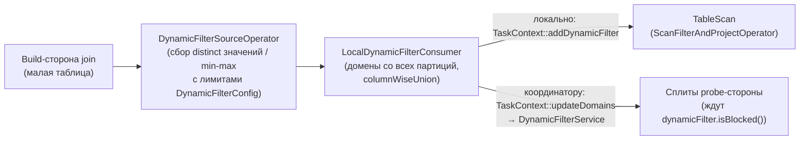

# 4. Выполнение JOIN в Trino

Код: `core/trino-main/src/main/java/io/trino/sql/planner/{plan,iterative/rule,optimizations}`,
`core/trino-main/src/main/java/io/trino/operator/join/**`, `io.trino.operator`.

В этой версии Trino физические стратегии join: **hash join (lookup join)** — основная,
**nested loop join** (cross join), **semi join** (IN/EXISTS), **spatial join**, **index join**.
Sorted merge join **отсутствует** в кодовой базе (нет ни план-узла, ни оператора).

## 4.1. План-узлы

- `.../planner/plan/JoinNode.java`: `JoinType {INNER, LEFT, RIGHT, FULL}`, equi-критерии
  (`EquiJoinClause`), не-equi `filter`, `DistributionType {PARTITIONED, REPLICATED}`,
  `spillable`, `Map<DynamicFilterId, Symbol> dynamicFilters` (значение — символ **правой (build)
  стороны**), `maySkipOutputDuplicates`, `reorderJoinStatsAndCost`.
  Инвариант: REPLICATED запрещён для RIGHT/FULL. Cross join — `JoinNode` без criteria и filter.
- `SemiJoinNode` — свой `DistributionType` и `Optional<DynamicFilterId>`.
- `SpatialJoinNode` — spatial-предикаты (`ST_Contains`, `ST_Distance <= r`...), kdb-tree.
- Операторные типы: `io.trino.operator.join.JoinType {INNER, PROBE_OUTER (SQL LEFT), LOOKUP_OUTER (SQL RIGHT), FULL_OUTER}`; маппинг в `JoinOperatorType.ofJoinNodeType(...)`; флаг `waitForBuild` — probe ждёт окончания build (для dynamic filtering).

## 4.2. Выбор стратегии распределения

### DetermineJoinDistributionType (`.../iterative/rule/DetermineJoinDistributionType.java`)
- session-свойство `join_distribution_type` = `AUTOMATIC` (default) | `PARTITIONED` | `BROADCAST`, лимит `join_max_broadcast_table_size`;
- при AUTOMATIC — **cost-based**: кандидаты (исходный + `flipChildren()`) × (REPLICATED, PARTITIONED), стоимость через `CostCalculatorWithEstimatedExchanges.calculateJoinCostWithoutOutput(probe, build, stats, replicated, taskCount)`:
  - REPLICATED: network = `buildSize * taskCount` (broadcast) + локальная репартиция build; PARTITIONED: network = repartition probe + build;
  - сравнение минимумов через `CostComparator`; при unknown-статах — size-based fallback (`getSizeBasedJoin`): малая сторона ≤ лимита → broadcast; иначе PARTITIONED с переворотом, если одна сторона больше другой в `SIZE_DIFFERENCE_THRESHOLD = 8` раз;
- `mustPartition`: RIGHT/FULL (иначе дублирование unmatched строк); `mustReplicate`: нет equi-условий (cross join) или правая сторона scalar;
- то же для semi join — `DetermineSemiJoinDistributionType`.

### ReorderJoins
`join_reordering_strategy=AUTOMATIC` — `ReorderJoins` + `MultiJoinNode`/`JoinGraph` (до 63 источников, лимит `max-reordered-joins`); `EliminateCrossJoins` — отдельная стратегия.

### AddExchanges.visitJoin (`.../optimizations/AddExchanges.java`)
- **REPLICATED**: правая (build) сторона → `replicatedExchange(REMOTE)` (broadcast); если probe single-node — `gatheringExchange`; спец-случай распределённого cross join — `roundRobinExchange`;
- **PARTITIONED**: если левая сторона уже распределена по leftSymbols — правая приводится к транслированной партиционировке, иначе обе — `partitionedExchange(REMOTE, joinKeys)` (hash по equi-ключам);
- bucket-схемы коннекторов (Iceberg bucket execution) могут дать co-located скан без exchange — см. [10](10-iceberg-statistics-optimization.md), `PartitioningHandleReassigner`.

### Статистики join (`io.trino.cost.JoinStatsRule`)
- база — cross join (`left * right`);
- INNER: equi-условия как коррелированная конъюнкция (`PlanNodeStatsEstimateMath.estimateCorrelatedConjunctionRowCount`, фактор `join_multi_clause_independence_factor`), затем не-equi filter (`FilterStatsCalculator`); для каждой equi-пары NDV пересекаются диапазоны (`retainedNdv = min(leftNdvInRange, rightNdvInRange)`);
- LEFT/RIGHT/FULL: inner-часть + join complement (эвристика unmatched NDV coefficient 0.5).

## 4.3. Физический hash join (LookupJoinOperator + HashBuilderOperator)

### Компоновка (LocalExecutionPlanner.createLookupJoin)
Весь join выполняется **в одном stage/задаче**:
- **probe-pipeline**: исходный пайплайн + `LookupJoinOperator` в конце;
- **build-pipeline**: отдельный `DriverFactory` (`addDriverFactory(false, ...)` — не input driver) с `HashBuilderOperator`;
- для RIGHT/FULL — дополнительный driver с `LookupOuterOperator` (выдаёт непревзойдённые build-строки).

Выбор реализации: `io.trino.operator.join.spilling.*` (по умолчанию, если spill включён или
`force_spilling_join`) либо `io.trino.operator.join.nonspilling.*`. Spill не поддерживается для
build-outer (RIGHT/FULL) и требует фиксированного `driverInstanceCount`.

### Build side: HashBuilderOperator
- страницы копятся в `PagesIndex`; каждый экземпляр оператора строит **один partition** lookup source;
- по `finish()` — `index.createLookupSourceSupplier(...)` → `io.trino.operator.join.JoinHashSupplier` → **`JoinHash`** (реализация `LookupSource`): `PositionLinks` (`SortedPositionLinks` при sort-канале, иначе `ArrayPositionLinks`) + `PagesHash` (`BigintPagesHash` для единственного BIGINT-канала, иначе `DefaultPagesHash`);
- результат отдаётся `PartitionedLookupSourceFactory.lendPartitionLookupSource(partitionIndex, ...)`;
- при spill — память revocable, индекс льётся в `SingleStreamSpiller`.

### Мост build↔probe
- `JoinBridgeManager<T extends JoinBridge>` — владелец моста, ссылочный счётчик жизненного цикла; когда probe/outer завершены — `joinBridge.destroy()`;
- `spilling/PartitionedLookupSourceFactory`: partitionCount — степень 2; когда все партиции переданы:
  - >1 → **`PartitionedLookupSource`** (позиция кодируется `(partition << shiftSize) | joinPosition`, партиция вычисляется по rawHash через `LocalPartitionGenerator`);
  - 1 + outer → `OuterLookupSource`; 1 без outer — прямой supplier;
- probe-операторы получают `LookupSourceProvider` (`SpillAwareLookupSourceProvider` кэширует per-provider).

### Probe side: LookupJoinOperator + DefaultPageJoiner
`io.trino.operator.join.DefaultPageJoiner.process(probePage)` — постранично:
1. `JoinProbe` для страницы (`getCurrentJoinPosition` → `lookupSource.getJoinPosition(position, probePage, page)`; NULL в ключах → -1);
2. цикл `joinCurrentPosition → outerJoinCurrentPosition → advanceProbePosition` с кооперативным yield:
   - `joinCurrentPosition`: пока `joinPosition >= 0`: `isJoinPositionEligible` (не-equi фильтр) → `pageBuilder.appendRow(probe, lookupSource, joinPosition)`; `outputSingleMatch` → максимум один матч на probe-строку;
   - `outerJoinCurrentPosition` (PROBE_OUTER/FULL_OUTER): если нет матча — `appendNullForBuild(probe)`;
3. вывод: `LookupJoinPageBuilder` — probe-сторона без копирования (dictionary/`getPositions`), build-сторона копируется в `PageBuilder`;
4. статистика: `JoinStatisticsCounter` (гистограмма match'ей → `JoinOperatorInfo` в UI).

### `outputSingleMatch`
`maySkipOutputDuplicates` ставится правилом `OptimizeDuplicateInsensitiveJoins` (дубликаты выхода не важны: EXISTS, semi-агрегации); включается, только если правые выходные символы ⊆ правых equi-символов.

## 4.4. Другие физические join

- **Nested loop (cross join)**: `NestedLoopBuildOperator` копит `NestedLoopJoinPages` (быстрый путь для пустых каналов — счётчик позиций); probe — `io.trino.operator.join.NestedLoopJoinOperator` (`NestedLoopOutputIterator`); для «пустых» выходных каналов — `RunLengthEncodedBlock` (умножение без данных); контроль переполнения `multiplyExact`.
- **Semi join (IN/EXISTS)**: build — `SetBuilderOperatorFactory` (`ChannelSet`), probe — `HashSemiJoinOperator` — добавляет boolean-колонку; семантика NULL: probe NULL при пустом set → false; значение не найдено, но в set есть NULL → NULL.
- **Spatial join**: `SpatialIndexBuilderOperatorFactory` (R-tree `PagesRTreeIndex`, опционально партиционирование по kdb-tree) + `SpatialJoinOperator` (INNER/LEFT).
- **Index join**: `IndexLookupSourceFactory` + `IndexBuildDriverFactoryProvider`; всегда через spilling-вариант с `unsupportedPartitioningSpillerFactory`.

## 4.5. Spilling hash join

Участники:
- build: `HashBuilderOperator` + `SingleStreamSpiller`; состояния `CONSUMING_INPUT → SPILLING_INPUT → INPUT_SPILLED → INPUT_UNSPILLING → INPUT_UNSPILLED_AND_BUILT → LOOKUP_SOURCE_BUILT`; при ревокации сначала `index.compact()` (цель освободить ≥20%), иначе spill всего индекса;
- probe: `DefaultPageJoiner` + `PartitioningSpiller.partitionAndSpill(page, spillMask)` (хэш тот же `LocalPartitionGenerator`);
- `PartitionedLookupSourceFactory.setPartitionSpilledLookupSourceHandle` — партиция помечается spilled, `spillEpoch` инкрементируется, probe при смене эпохи сохраняет текущую строку как `SavedRow`, хвост страницы льётся;
- после завершения probe (`finishProbeOperator`) spilled-партиции обрабатываются **по одной**: unspill build-партиции → join пролитых probe-страниц → release. Bounded memory: одна build-партиция + её probe-страницы.

Условия: `spill_enabled` + `JoinNode.spillable` + не build-outer; spill возможен только при фиксированном параллелизме (`AddLocalExchanges.visitJoin` ставит `spillable=false`, если probe-поток не FIXED distribution).

## 4.6. Dynamic Filtering (фильтрация скана значениями build-стороны)

Механизм позволяет до чтения данных отфильтровать сплиты/строки probe-таблицы (например, большой Iceberg-таблицы) по фактическим значениям build-стороны join.

- **Планировщик**: `PredicatePushDown.visitJoin → createDynamicFilters` — только INNER/RIGHT при `enable_dynamic_filtering`; для каждого build-символа выделяется `DynamicFilterId`; в probe-предикаты добавляются вызовы `df(...)`; `JoinNode.dynamicFilters` — map id → build Symbol; `RemoveUnsupportedDynamicFilters` вычищает фильтры без потребителя (DF поддерживаются только у TableScan на probe-стороне или нижележащего join); для fault-tolerant — `AddDynamicFilterSource` (сбор в отдельный `DynamicFilterSourceNode`).
- **Локальное исполнение**: на build-стороне перед `HashBuilderOperator`/`SetBuilderOperator` вставляется `DynamicFilterSourceOperatorFactory`; оператор (`io.trino.operator.DynamicFilterSourceOperator`) собирает по каналам `JoinDomainBuilder` — open-addressing таблицу distinct-значений и/или min/max (лимиты `maxDistinctValuesPerDriver`, `maxSizePerDriver`...; при исчерпании — фильтр отключается, `TupleDomain.all()`); домены объединяются и уходят потребителям.
- **Потребление**: `TableSpecificDynamicFilter` (SPI `DynamicFilter`) конвертирует домен build-символа в `TupleDomain<ColumnHandle>` probe-колонок (с учётом оператора сравнения и насыщенных кастов); `ScanFilterAndProjectOperator` передаёт его коннектору в `createPageSource(...)`; `ConnectorAwareSplitSource.getNextBatch` **ждёт** `dynamicFilter.isBlocked()` до таймаута коннектора; `DynamicPageFilter` перекомпилирует columnar-фильтр по фактическому домену.
- `waitForBuild`: если probe-сторона потребляет локальные DF — probe-оператор не читает данные до готовности build.

Для Iceberg это даёт: отсечение сплитов по partition-доменам и file statistics прямо в
`IcebergSplitSource` (см. [08](08-iceberg-read-path.md) и [10](10-iceberg-statistics-optimization.md)),
таймаут ожидания — `iceberg.dynamic-filtering.wait-timeout` (1s по умолчанию).

## 4.7. JOIN и Iceberg: практическая картина

- Join двух Iceberg-таблиц: обе стороны — `TableScanNode`; если таблицы партиционированы по equi-ключу одинаковыми bucket-функциями и включён bucket execution (`iceberg.bucket-execution-enabled=true`, ровно одна спека), движок может выполнить **co-located join** без repartition (`IcebergTablePartitioning` → `applyPartitioning` → `PartitioningHandleReassigner`).
- В противном случае: broadcast маленькой стороны (REPLICATED) или hash-репартицирование обеих (PARTITIONED); выбор — по статистикам из манифестов Iceberg (`TableStatisticsReader`, [10](10-iceberg-statistics-optimization.md)).
- Динамическая фильтрация применяется к сплитам Iceberg до открытия файлов: домен build-стороны пушится в `Scan.filter(...)` и в per-file `fileStatisticsDomain` — отсекаются манифесты, файлы и row groups.
