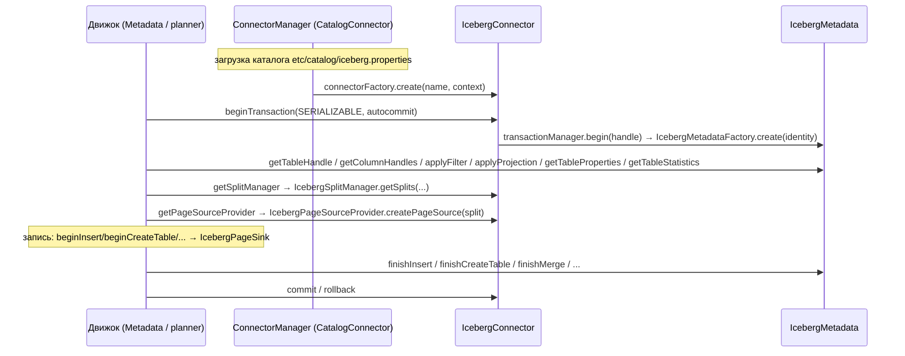

# 5. Connector SPI: как коннекторы встраиваются в движок

Код: `core/trino-spi/src/main/java/io/trino/spi/connector/**`, подключение — `io.trino.connector`
в `core/trino-main`. Iceberg-реализация — `plugin/trino-iceberg` (следующие документы).

## 5.1. Компоненты коннектора

`Connector` (SPI) отдаёт движку набор сервисов; для Iceberg — `.../iceberg/IcebergConnector.java`:

| Сервис SPI | Назначение | Реализация Iceberg |
|---|---|---|
| `ConnectorMetadata` | Каталог: таблицы/схемы/колонки, pushdown, транзакции записи | `IcebergMetadata` |
| `ConnectorSplitManager` | Планирование сплитов по таблице | `IcebergSplitManager` |
| `ConnectorPageSourceProvider` | Чтение сплита → страницы | `IcebergPageSourceProvider(Factory)` |
| `ConnectorPageSinkProvider` | Запись: page sinks, merge sinks | `IcebergPageSinkProvider` |
| `ConnectorNodePartitioningProvider` | Bucket-функции коннектора (co-located scans/writes) | `IcebergNodePartitioningProvider` |
| `ConnectorTransactionHandle` | Идентификатор транзакции коннектора | `HiveTransactionHandle` (переиспользуется) |
| `ConnectorAccessControl` | Права на уровне каталога | `IcebergSecurityModule` (ALLOW_ALL/READ_ONLY/FILE/SYSTEM) |
| Процедуры (`Procedures`) | CALL-процедуры | `register_table`, `unregister_table`, `rollback_to_snapshot`, `migrate` |
| Табличные процедуры (`TableProcedures`) | `ALTER TABLE ... EXECUTE` | `optimize`, `optimize_manifests`, `expire_snapshots`, ... |
| Системные таблицы (`getSystemTables`) | Метаданные как таблицы | `"$snapshots"`, `"$files"`, ... |
| Session/table/schema/view свойства | Конфигурация | `IcebergSessionProperties`, `IcebergTableProperties`, ... |

## 5.2. Жизненный цикл стыковки

Ключевые моменты:
- **Транзакция коннектора** создаётся на каждую транзакцию движка (`Connector.beginTransaction`), `isolationLevel` для Iceberg — всегда SERIALIZABLE; `IcebergTransactionManager` хранит `ConnectorTransactionHandle → MemoizedMetadata` (лениво создаёт `IcebergMetadata` с собственным `TrinoCatalog` для identity).
- Все handle'ы (`TableHandle`, `ColumnHandle`, `Split`) — сериализуемые объекты коннектора; движок ходит с ними опаково, кроме контрактов `TupleDomain<ColumnHandle>` (предикаты), `DynamicFilter` и т.п.
- Обёртки `ClassLoaderSafe*` изолируют вызовы в classloader'е плагина.

## 5.3. Pushdown-контракты (что движок спрашивает у коннектора)

- `applyFilter(session, tableHandle, Constraint)` → `ApplyResult`: коннектор делит предикат на
  `enforcedPredicate` (гарантированно применён — у Iceberg: партиции/метаданные-колонки),
  `unenforcedPredicate` (будет применён на чтении — file statistics) и `remainingConstraint` (движок сам).
  Движок убирает enforced из плана, оставляет FilterNode для remaining.
- `applyProjection` — колоночная прунуляция (у Iceberg включая вложенные dereference — projected columns с path из field id).
- `getTableProperties` → `ConnectorTableProperties`: `predicate`, `discretePredicates` (для `MetadataQueryOptimizer`: min/max/distinct по партициям без скана), `tablePartitioning` (co-located execution).
- `getStatisticsCollectionMetadata` + `finishStatisticsCollection` — ANALYZE.
- `ConnectorTableLayout`-методы `getInsertLayout`/`getWriteLayout`/`getUpdateLayout` — распределение записи (у Iceberg — партиционированная запись и row-level update по file path).
- Merge-контракт: `getMergeLayout` (row-id колонка + update partitioning), `ConnectorMergeSink`, парадигма `getRowChangeParadigm()` — у Iceberg всегда `DELETE_ROW_AND_INSERT_ROW`.
- `ConnectorSplitManager.getSplits(..., dynamicFilterColumns, constraint)` + `DynamicFilterSnapshot` в `getNextBatch` — dynamic filtering на этапе планирования сплитов; `getRequestedDynamicFilterWaitTimeoutMillis()` — сколько ждать.
- `getTableCredentials` — пуш пер-табличных credentials (S3 vended credentials) в воркеры.

## 5.4. Как движок исполняет DML через коннектор

- INSERT: `beginInsert` → движок строит `TableWriterNode` (воркеры пишут через `ConnectorPageSink`, возвращают **fragments** — сериализованные `CommitTaskData`) → `TableFinishNode` на координаторе вызывает `finishInsert(fragments)` — там Iceberg-коммит.
- CTAS: `beginCreateTable` (staged Iceberg `Transaction`) → запись → `finishCreateTable`.
- DELETE/UPDATE/MERGE: движок строит `MergeProcessorNode` + `MergeWriterNode`; скан с row-id колонкой коннектора, затем `ConnectorMergeSink` пишет вставки/удаления; `finishMerge` коммитит `RowDelta`.
- Metadata-only DELETE: `applyDelete`/`executeDelete` (у Iceberg — если предикат только по метаданным/партициям, выполняется `newDelete().deleteFromRowFilter(...)` без скана).
