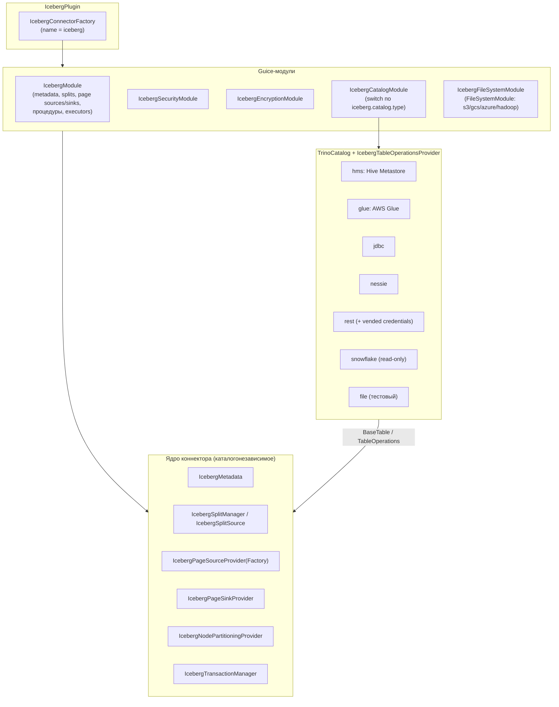
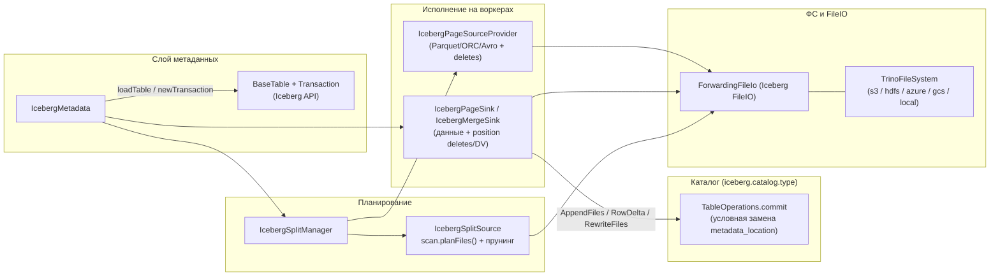

# 6. Iceberg-коннектор: структура, каталоги, конфигурация

Код: `plugin/trino-iceberg` (все пути ниже — от `plugin/trino-iceberg/src/main/java/`).
Используется библиотека Apache Iceberg 1.12.0. Подключается как `connector.name=iceberg`.

## 6.1. Модульная структура

- `IcebergConnectorFactory.create` собирает Bootstrap из модулей; каталог-специфичный модуль выбирается по `iceberg.catalog.type` (`.../catalog/IcebergCatalogModule.java`).
- `IcebergModule.setup` биндит: `IcebergTransactionManager`, `IcebergMetadataFactory`, session/table/view/MV properties, split manager и page source/sink providers (в `ClassLoaderSafe*`), конфиги (ORC/Parquet reader/writer), `DeletionVectorWriter`, `TableStatisticsReader/Writer`, процедуры, табличную функцию `table_changes`, системную таблицу `iceberg_tables`, пулы потоков `@ForIcebergSplitManager/@ForIcebergMetadata/@ForIcebergPlanning/@ForIcebergSplitSource/@ForIcebergFileDelete` (`IcebergExecutorModule`).
- `IcebergConnector.beginTransaction` требует SERIALIZABLE и создаёт `HiveTransactionHandle(autoCommit)`; commit/rollback — у `IcebergTransactionManager`.

## 6.2. Каталоги (`CatalogType`)

`CatalogType` (enum): `TESTING_FILE_METASTORE, HIVE_METASTORE, GLUE, REST, JDBC, NESSIE, SNOWFLAKE`
(свойство `iceberg.catalog.type`, по умолчанию `HIVE_METASTORE`).

Центральные абстракции `.../catalog/`:
- **`TrinoCatalog`** — «Iceberg `Catalog` под Trino»: `ConnectorSession` первым аргументом, `SchemaTableName`, `Map<String,Object>`; методы: namespaces, `listTables`, `loadTable → BaseTable`, `newCreateTableTransaction`, `newTransaction`, `registerTable/unregisterTable`, `dropTable/renameTable`, views/MV, `defaultTableLocation`, `redirectTable`.
- **`TrinoCatalogFactory.create(ConnectorIdentity)`** — фабрика на транзакцию.
- **`AbstractTrinoCatalog`** — общая база: `newCreateTableTransaction` (через `Transactions.createTableTransaction`), `createNewTableName` (uuid-суффикс при `iceberg.unique-table-location=true` — по умолчанию), создание MV storage-таблиц, measured file system (`MeasuredTrinoFileSystemFactory` + `ApiCallStats`).
- **`IcebergTableOperationsProvider`** — фабрика `TableOperations` для каталога (см. [07](07-iceberg-metadata-transactions.md)).

### Сравнение каталогов

| Каталог | Реализация | Особенности коммита и хранения |
|---|---|---|
| `HIVE_METASTORE` | `TrinoHiveCatalog` + `HiveMetastoreTableOperations` | Таблица регистрируется в HMS с `TABLE_TYPE=ICEBERG`, `EXTERNAL=TRUE`; коммит — условная замена `metadata_location` (`replaceTable` с expected-параметрами; опциональный Hive-lock `ThriftMetastore.acquireTableExclusiveLock`); ошибки вида «table has been modified» (HIVE-26882/28121) распознаются как конкурентный конфликт; per-transaction кэш метаданных (1000 таблиц); bulk-листинг через `getTableNamesWithParameters` |
| `GLUE` | `TrinoGlueCatalog` + `GlueIcebergTableOperations` | `glueClient.updateTable(..., glueVersionId)` — OCC через version id; `ConcurrentModificationException` → проверка фактического статуса коммита; `AlreadyExistsException` при create → `checkNewTableCommit` |
| `JDBC` | `TrinoJdbcCatalog` + `IcebergJdbcTableOperations` | Обёртка над Iceberg `JdbcCatalog`; коммит — условный `UPDATE ... SET metadata_location = new WHERE ... = current`; драйвер грузится по классу (`iceberg.jdbc-catalog.driver-class`); MV через отдельные storage-таблицы |
| `NESSIE` | `TrinoNessieCatalog` + `IcebergNessieTableOperations` | `nessieClient.commitTable(...)`; `NessieConflictException` → `CommitFailedException` (автоповтор Iceberg); метаданные обогащаются Nessie-свойствами |
| `REST` | `TrinoRestCatalog` (напрямую реализует `TrinoCatalog`) | Поверх Iceberg `RESTSessionCatalog`; security: OAUTH2/SIGV4/GOOGLE/NONE; **vended credentials** (`VendedCredentialsProvider` + `IcebergRestCatalogFileSystemFactory`) — временные креды к S3/Azure/GCS от REST-сервера; nested namespaces (`.`-разделитель); case-insensitive matching имён |
| `SNOWFLAKE` | `TrinoSnowflakeCatalog` + патченный `org.apache.iceberg.snowflake.SnowflakeIcebergTableOperations` | **Read-only**: `verifyTableWritable` и все `commit*` → `NOT_SUPPORTED`; делегирует `SnowflakeTableOperations`; namespace 2 уровня (database, schema) |
| `TESTING_FILE_METASTORE` | `FileMetastoreTableOperations` | Для тестов: commit — сравнение `metadata_location` в file-metastore |

Важно: **вся остальная логика коннектора (метаданные, сплиты, чтение, запись) каталогонезависима** — каталог виден только через `TrinoCatalog`/`TableOperations`.

## 6.3. Конфигурация (`IcebergConfig`)

Наиболее важные свойства (префикс `iceberg.`):

| Свойство | Default | Смысл |
|---|---|---|
| `catalog.type` | `HIVE_METASTORE` | Тип каталога |
| `file-format` | `PARQUET` | Формат новых файлов (PARQUET/ORC/AVRO) |
| `compression-codec` | `ZSTD` | Кодек сжатия |
| `format-version` | `2` (поддержка 1–3) | Версия формата таблиц по умолчанию |
| `unique-table-location` | `true` | Локация таблиц с uuid-суффиксом (защита от коллизий) |
| `target-max-file-size` | `1GB` | Целевой размер файла записи (roll-over) |
| `idle-writer-min-file-size` | `16MB` | Порог закрытия простаивающих writer'ов (scaling writers) |
| `max-partitions-per-writer` | `100` | Лимит открытых партиций на writer |
| `max-split-size` | — | Максимальный размер сплита (иначе из `read.split.target-size` таблицы) |
| `minimum-assigned-split-weight` | `0.05` | Минимальный вес сплита |
| `table-statistics-enabled` | `true` | Статистики для оптимизатора |
| `extended-statistics.collect-on-write` | `true` | Инкрементальный сбор NDV при INSERT/CTAS |
| `projection-pushdown-enabled` | `true` | Прунуляция колонок (включая nested) |
| `dynamic-filtering.wait-timeout` | `1s` | Ожидание dynamic filter при планировании сплитов |
| `query-partition-filter-required` | `false` | Требовать partition-фильтр в запросах |
| `sorted-writing-enabled` | `true` | Сортированная запись (external merge sort) |
| `incremental-refresh-enabled` | `true` | Инкрементальный refresh materialized views |
| `bucket-execution-enabled` | `true` | Co-located сканы/записи bucketed-таблиц |
| `metadata-cache-enabled` | `true` | Кэш метаданных на координаторе |
| `object-store-layout.enabled` | `false` | Object-store layout путей данных |
| `parquet-footer-cache.type` | `NONE` | Кэш Parquet-футеров (`NONE`/`MEMORY`, размер `...memory-max-size=10MB`) |
| `expire-snapshots.min-retention` / `remove-orphan-files.min-retention` | `7d` | Минимальные retention процедур |
| `register-table-procedure.enabled` / `add-files-procedure.enabled` | `false` | Гейты процедур |
| `hive-catalog-name` | — | Редирект не-Iceberg таблиц в Hive-каталог |

Session-свойства (`IcebergSessionProperties`) дублируют ключевые переключатели per-query:
`max_split_size`, `statistics_enabled`, `projection_pushdown_enabled`, `dynamic_filtering_wait_timeout`,
`collect_extended_statistics_on_write`, `merge_manifests_on_write`, `sorted_writing_enabled`,
`query_partition_filter_required`, `incremental_refresh_enabled`, `bucket_execution_enabled`,
`max_partitions_per_writer`, `minimum_assigned_split_weight`, `use_file_size_from_metadata`,
`idle_writer_min_file_size`, retention-свойства + полный набор ORC/Parquet reader/writer настроек.

Табличные свойства (`IcebergTableProperties`, задаются при CREATE TABLE):
`format`, `partitioning`, `sorted_by`, `location`, `format_version` (1–3), `compression_codec`,
`max_commit_retry`, `delete_after_commit_enabled`, `max_previous_versions`,
`orc_bloom_filter_columns/fpp`, `parquet_bloom_filter_columns`, `target_max_file_size`,
`parquet_writer_row_group_size`, `object_store_layout_enabled`, `data_location`, `gc_enabled`,
`extra_properties` (белый список `iceberg.allowed-extra-properties`).

## 6.4. Имена таблиц и системные суффиксы

`.../iceberg/IcebergTableName.java` — regex `(?<table>[^$@]+)(?:\$(?<type>...))?`; `TableType`:
`DATA, HISTORY, METADATA_LOG_ENTRIES, SNAPSHOTS, ALL_MANIFESTS, MANIFESTS, PARTITIONS, FILES,
ALL_ENTRIES, ENTRIES, PROPERTIES, REFS, MATERIALIZED_VIEW_STORAGE`.
Например `t$snapshots`, `t$files`, `t$manifests`; `t$materialized_view_storage` — скрытая
storage-таблица MV. `partitions` (без `$`) — view поверх `$files` (агрегаты по партициям).
Неизвестный суффикс → `UnknownTableTypeException` (`UNSUPPORTED_TABLE_TYPE`).

## 6.5. Поток данных в коннекторе (сводка)

