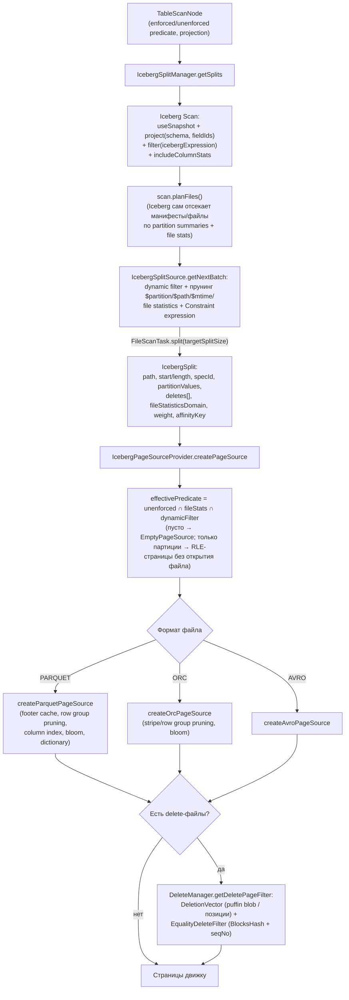

# 8. Путь чтения Iceberg: сплиты, форматы файлов, deletes, кэши

Код: `plugin/trino-iceberg/src/main/java/io/trino/plugin/iceberg/`
(`IcebergSplitManager.java`, `IcebergSplitSource.java`, `IcebergPageSourceProvider.java`,
`delete/**`), библиотеки `lib/trino-orc`, `lib/trino-parquet`, `lib/trino-filesystem`, `lib/trino-cache`.

## 8.1. Общая цепочка чтения

## 8.2. Планирование сплитов (IcebergSplitManager → IcebergSplitSource)

- `getSplits`: без снапшота — пустой источник; строится `Scan` (private `getScan`):
  `icebergTable.newScan().useSnapshot(snapshotId).project(TypeUtil.select(schema, projectedIds)).planWith(@ForIcebergSplitManager executor)`; для инкрементального refresh MV — `newIncrementalAppendScan().fromSnapshotExclusive(...).toSnapshot(...)`.
- **IcebergSplitSource.getNextBatch(maxSize, DynamicFilterSnapshot)** — асинхронно (пул `@ForIcebergSplitSource`), при первом вызове:
  - dynamic filter конвертируется в Iceberg-выражение (для партиционных колонок — целиком; для остальных `simplify(200)` — лимит IN-предикатов Iceberg);
  - `effectivePredicate = dataColumnPredicate ∩ unenforcedPredicate ∩ dynamicFilter`; `scan.filter(...)`; при предикатных колонках — `scan.includeColumnStats(...)` (нужны lower/upper для прунинга);
  - `planFiles()` — Iceberg сам отсекает манифесты (по partition summaries) и файлы (по file statistics) через свои evaluator'ы;
- далее per-file прунинг в Trino (`pruneFileScanTask`):
  - `$partition` (partitionToPath vs partitionDomain), `$path`, `$file_modified_time` (реальный lastModified через ФС);
  - dynamic filter: `fileStatisticsDomain().overlaps(predicate)` (TupleDomain из манифестных статистик: lowerBounds/upperBounds/nullCounts/nanCounts);
  - выражение `Constraint.getExpression()` через `PartitionConstraintMatcher` (кэш 1000);
- разбиение: `fileScanTask.split(targetSplitSize)`; target = session `max_split_size` либо табличное `read.split.target-size` (`tableScan.targetSplitSize()`); при явно заданном session-размере соседние сплиты мержатся;
- **вес сплита** (`getSplitWeight`): `dataWeight = length/targetSplitSize` + удвоение при позиционных делетах + `equalityDeletes * dataWeight`; кламп в `[minimum_assigned_split_weight=0.05, 1.0]`;
- `affinityKey` — для cache-aware scheduling (сплиты одного blob-файла — на один воркер);
- метрики планирования (из `ScanReport`): `scanPlanningDuration`, `dataFiles`, `skippedDataManifests`, `deleteFiles`, `positionalDeleteFiles`, `deletionVectorFiles`, ...

## 8.3. IcebergPageSourceProvider

1. Системные сплиты `$files` → `FilesTablePageSource`.
2. Парсинг schema/spec; `PartitionData.fromBlocks(...)`.
3. `effectivePredicate` = `unenforcedPredicate ∩ fileStatisticsDomain ∩ dynamicFilter.getCurrentPredicate()`, упрощение (`domainCompactionThreshold`); `none` → `EmptyPageSource`.
4. **Быстрый путь**: предикат all + сплит покрывает весь файл + нет делетов + читаются только партиционные колонки → генерация RLE-страниц без открытия файла.
5. Для делетов добавляются служебные колонки: `ROW_POSITION` (позиционные), equality-колонки.
6. `createDataPageSource` — switch по `IcebergFileFormat` (PARQUET/ORC/AVRO).
7. При наличии `split.deletes()` — ленивый `PageFilter` от `DeleteManager`; page source оборачивается в `TransformConnectorPageSource` (фильтрация страниц, отсечение лишних каналов).

## 8.4. Delete-файлы (пакет `delete/`)

Trino **читает** все три вида удалений, но **пишет** только позиционные (v2: parquet/orc-файлы;
v3: deletion vectors в puffin); equality deletes читает, но никогда не пишет.

Привязка: `FileScanTask.deletes()` → record `DeleteFile` (`content, path, format, recordCount,
fileSize, equalityFieldIds, rowPositionLowerBound/UpperBound, dataSequenceNumber,
contentOffset/contentSize` для DV). `isDeletionVector()` = POSITION_DELETES + PUFFIN + offset/size.

### DeleteManager (`delete/DeleteManager.java`)
- один менеджер на unpartitioned-таблицу и `Map<PartitionKey, DeleteManager>` для партиционированных (equality-фильтры шарятся между сплитами одной партиции);
- **если у файла есть deletion vector — позиционные delete-файлы игнорируются**;
- DV читается из puffin-блоба (`TrinoInput.readFully(contentOffset, contentSize)`);
- иначе `PositionDeleteReader.readPositionDeletes(...)`: чтение parquet/orc delete-файлов (колонки `path`+`pos`), фильтр `path = dataFilePath AND pos ∈ [startRowPosition, endRowPosition]`; скип файла по статистикам позиций; результат — `DeletionVector.Builder`;
- итоговый фильтр: `!vector.isRowDeleted(filePosition)` — `filePosition` берётся из канала row-position (ридеры добавляют номер строки).

### EqualityDeleteFilter / EqualityDeleteFilterBuilder
- по одному билдеру на набор equality-колонок: `FlatHashEqualityDeleteFilterBuilder` — `BlocksHash` + sequence numbers (`EqualityDeleteIndex` под RW-lock);
- каждый delete-файл читается один раз (`ListenableFutureTask` в `ConcurrentHashMap`, параллельные загрузки ждутся);
- строка удалена, если ключ найден и его delete sequence number **строго больше** `splitDataSequenceNumber` (семантика Iceberg).

### DeletionVector (`delete/DeletionVector.java`)
- массив `RoaringBitmap`: ключ — старшие 32 бита позиции, значение — bitmap младших 32 бит;
- сериализация: `[length BE][magic 0x64 39 D3 D1][bitmapCount][key+bitmap]*[CRC32]`; лимит 2GB (`ICEBERG_DELETION_VECTOR_TOO_LARGE`).

## 8.5. Чтение Parquet (`lib/trino-parquet`)

- `ParquetDataSource` (+ `ParquetFooterCache` — см. 8.7); для шифрованных файлов `FileDecryptionProperties`.
- Схема: `createParquetIdToFieldMapping` (Iceberg field id ↔ parquet поле, `PARQUET:.field.id`); `projectSufficientColumns` — минимальный покрывающий префикс для dereference; `IcebergParquetColumnIOConverter.constructField` — Field-дерево по id.
- **Predicate**: `getParquetTupleDomain` → `TupleDomainParquetPredicate`; отключается `parquet_ignore_statistics`.
- **Row group pruning** (`PredicateUtils.getFilteredRowGroups`): min/max статистики блока → column index (page-level, `parquet_use_column_index`) → bloom filter (`parquet_use_bloom_filter`) → dictionary-предикаты (чтение dictionary page).
- `ParquetReader` читает только отобранные row groups; column index вырезает диапазоны строк внутри группы (метрика `COLUMN_INDEX_ROWS_FILTERED`); опции `parquet_max_read_block_size`, `parquet_vectorized_decoding_enabled`...
- `startRowPosition/endRowPosition` (из первого/последнего row group) — для позиционных делетов.

## 8.6. Чтение ORC (`lib/trino-orc`) и Avro

- `TrinoOrcDataSource` поверх `TrinoInputFile`; маппинг колонок по Iceberg field id из ORC-атрибутов (`OrcIcebergIds`, атрибут `iceberg.id` проставляется writer'ом), fallback — `NameMapping`.
- Predicate: `TupleDomainOrcPredicate` (+ bloom при `orc_bloom_filters_enabled`).
- Stripe pruning (`OrcRecordReader`: только страйпы в диапазоне сплита + прошедшие predicate по file/stripe stats; мелкие страйпы кэшируются целиком); row group pruning (`StripeReader.selectRowGroups`).
- Отсутствующие в файле колонки → константы: партиционные ключи, `$partition`, `$path`, `$file_modified_time`, initial-default из схемы; `$row_id` — `RowIdTransform(fileFirstRowId, ordinal)`.
- Avro (`IcebergAvroPageSource`): Iceberg `Avro.read(...).project(...).split(start, length)`; pushdown отсутствует; номер строки — локальный счётчик.

## 8.7. Кэширование

| Кэш | Где | Управление |
|---|---|---|
| Parquet footer | `MemoryParquetFooterCache` (lib/trino-parquet) | `iceberg.parquet-footer-cache.type=MEMORY`, `...memory-max-size=10MB` (default NONE) |
| Blob-кэш файлов | `CacheFileSystem` (lib/trino-filesystem/.../cache) + плагины `trino-blob-cache-memory`, `trino-blob-cache-alluxio` | `fs.cache.enabled` на каталог; ключ — `IcebergCacheKeyProvider` (компоненты location: файлы Iceberg иммутабельны); запись/удаление инвалидируют |
| Split affinity | `SplitAffinityProvider` / `CacheSplitAffinityProvider` | при включённом кэше — consistent-hash по `path:offset:length` |
| Метаданные каталога | per-transaction кэши `TrinoCatalog`'ов (HMS 1000 таблиц, REST 1000) | `iceberg.metadata-cache-enabled` |
| ManifestEvaluator'ы | `TableStatisticsReader` (`NonEvictableLoadingCache` 1000) | автоматически |
| Манифесты | читаются напрямую (`IcebergManifestUtils` обходит внутренний кэш `BaseSnapshot.allManifests` для экономии памяти) | — |

Отдельного кэша сплитов нет; кэша deletion vectors нет (DV-файлы покрываются blob-кэшем).

## 8.8. Метаданные-колонки при чтении

| Колонка | Тип | Откуда |
|---|---|---|
| `$path` | VARCHAR | путь файла из сплита |
| `$partition` | VARCHAR(row) | partition values сплита |
| `$file_modified_time` | TIMESTAMP_TZ | `inputFile.lastModified()` |
| `$row_position` | BIGINT (hidden) | добавляется ридерами для делетов |
| `$row_id` | BIGINT (v3) | `fileFirstRowId` (из манифеста) + позиция, либо физическая колонка v3 |
| `$last_updated_sequence_number` | BIGINT (v3) | data sequence number файла |

`ReferencedDataFile` (path, recordCount, fileSize, format) — ссылки на файлы для row-level операций (возвращаются из скана в finish через `splitSourceInfo`).
