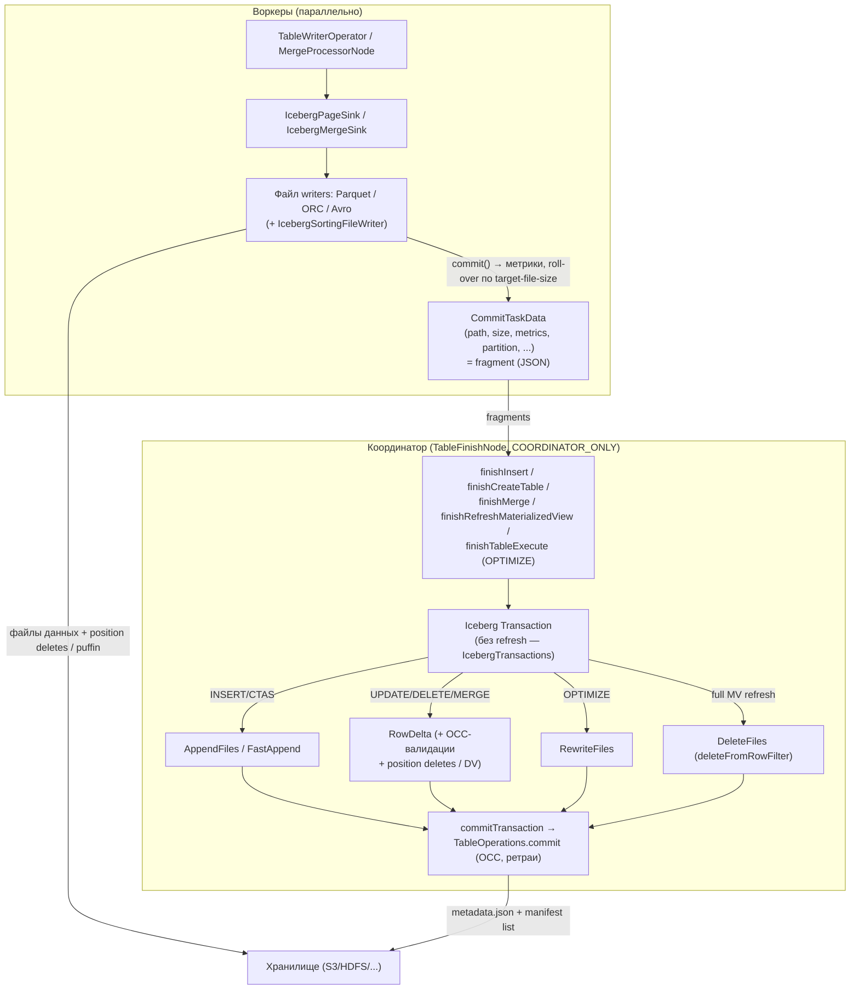

# 9. Путь записи Iceberg: INSERT/CTAS/UPDATE/DELETE/MERGE, OPTIMIZE

Код: `plugin/trino-iceberg/src/main/java/io/trino/plugin/iceberg/` — `IcebergPageSinkProvider.java`,
`IcebergPageSink.java`, `IcebergMergeSink.java`, `IcebergFileWriterFactory.java`,
`delete/PositionDeleteWriter.java`, `delete/DefaultDeletionVectorWriter.java`, `procedure/*`.

## 9.1. Две фазы записи

`IcebergPageSinkProvider` создаёт sink'и по типу handle:
- `ConnectorOutputTableHandle` — CTAS; `ConnectorInsertTableHandle` — INSERT / refresh MV;
- `ConnectorTableExecuteHandle` — OPTIMIZE (остальные процедуры coordinator-only);
- `createMergeSink(ConnectorMergeTableHandle)` — UPDATE/DELETE/MERGE (`IcebergMergeSink` вокруг обычного `IcebergPageSink`; format v3 добавляет к выходу `ROW_ID`).

## 9.2. IcebergPageSink: партиционированная запись

- **Партиционирование на лету**: `PagePartitioner.partitionPage` → `PageIndexerFactory` индексирует страницу по трансформированным partition-блокам (`PartitionTransforms.getColumnTransform`); строки расходятся по writer'ам (по одному на партицию); значения партиций вычисляются iceberg `Transform.bind(type).apply(value)` → `PartitionData` (реализация `StructLike`).
- **Roll-over**: writer превысил `targetMaxFileSizeBytes` (`write.target-file-size-bytes` или `iceberg.target-max-file-size=1GB`) → закрыть, открыть новый. Имя файла: `{queryId}-{uuid}.{ext}` (queryId — для opportunistic cleanup после сбоев). Путь: `LocationProvider.newDataLocation(spec, partitionData, fileName)`.
- **Лимиты**: `maxPartitionsPerWriter` (session `max_partitions_per_writer` ≤ 100) — иначе `ICEBERG_TOO_MANY_OPEN_PARTITIONS`.
- **Scaling writers**: `closeIdleWriters()` — закрывает writer'ы без данных в текущем раунде, записавшие больше `idle-writer-min-file-size=16MB`; вызывается движком (`TableWriterOperator.tryClosingIdleWriters`) при росте физического объёма записи.
- **Sorted writing** (`sorted_writing_enabled`): `IcebergSortingFileWriter` — external merge sort (буфер в памяти → спилл-файлы → k-way merge через `PageSorter`); сортировка по табличным `sorted_by` (только identity-поля).
- **finish()**: для каждого writer'а `commit()` → `RollbackAction` (удаление при abort); `verifyNotNullConstraint` (nullValueCounts required-полей); `CommitTaskData(path, fileFormat, writtenBytes, MetricsWrapper, specId, partitionDataJson, DATA, referencedDataFile, splitOffsets, sortOrderId, serializedDeletionVector)`.
- **abort()**: выполняет все `RollbackAction` (удаление файлов), аккумулируя suppressed exceptions.

### Распределение записи
`getInsertLayout/getWriteLayout`: unpartitioned → пусто (движок сам решает); partitioned с identity → `ConnectorTableLayout(partitioningColumnNames)` (движок репартиционирует по статистикам); transform-партиционирование (включая bucket) → `IcebergPartitioningHandle` с forceRepartitioning. UPDATE (`getUpdateLayout`) — всегда force + `forUpdate()` (bucket по hash(file path) — строки одного файла к одному writer'у).

## 9.3. Файловые writer'ы (`IcebergFileWriterFactory`)

| Writer | Реализация | Особенности |
|---|---|---|
| Parquet | `IcebergParquetFileWriter` (обёртка над hive `ParquetFileWriter`) | схема из `IcebergParquetSchemaConverter` (field-id через `parquet.field.id`); метрики `ParquetUtil.footerMetrics` (columnSizes, valueCounts, nullCounts, nanCounts, lower/upperBounds по row groups); splitOffsets — офсеты row groups; кодек из `compression_codecs`/`write.parquet.compression-codec` |
| ORC | `IcebergOrcFileWriter` | `OrcTypeConverter` — атрибуты `iceberg.id`, `iceberg.required`, ...; метрики `OrcMetrics.computeMetrics`; splitOffsets — страйпы; bloom-фильтры (`orc_bloom_filter_columns`); опциональная валидация записи |
| Avro | `IcebergAvroFileWriter` | Iceberg `Avro.write(...)`, конвертация Page → Record |
| Position deletes | `delete/PositionDeleteWriter` | схема `path varchar, pos bigint`; имя `{queryId}-{uuid}.{ext}`; страницы: path — RLE-константа, pos — LongArrayBlock по 4K |
| Deletion vectors | `delete/DefaultDeletionVectorWriter` | пишется на координаторе в общий puffin-файл (см. 9.5) |

Geospatial-типы (GEOMETRY/GEOGRAPHY) рекурсивно конвертируются в `binary` при записи
(EWKB→WKB валидация SRID); в метаданных таблицы исходный тип сохраняется.

`MetricsWrapper` — JSON-обёртка iceberg `Metrics`: recordCount, columnSizes, valueCounts,
nullValueCounts, nanValueCounts, lowerBounds/upperBounds — именно они попадают в манифесты
и используются потом для file-level прунинга при чтении.

## 9.4. Location providers

`IcebergUtil.getLocationProvider` (кастомный `write.location-provider.impl` запрещён):
- `DefaultLocationProvider` (util/): `write.data.location` (или `<table>/data`) + `partitionToPath` + имя файла;
- `ObjectStoreLocationProvider`: hash-префикс murmur3_32 (URL-base64) от имени файла:
  `storageLocation/<hash>/<context>/<filename>`; `write.object-storage.partitioned-paths` — включать ли партиционные пути. Включается свойством `object_store_layout_enabled` (или `iceberg.object-store-layout.enabled`).

## 9.5. Row-level операции: UPDATE / DELETE / MERGE

Парадигма — всегда **DELETE_ROW_AND_INSERT_ROW**: движок (`MergeProcessorNode`) превращает
обновления в пары UPDATE_DELETE + UPDATE_INSERT, `IcebergMergeSink` разделяет поток:

- **Вставки** → обычный `IcebergPageSink`; для **format v3** к вставкам добавляется колонка row ID: INSERT → null (назначит Iceberg), UPDATE_INSERT → сохранённый `source_row_id` (lineage).
- **Удаления** → `FileDeletion` (группировка по file path; run'ы строк одного файла идут подряд): накапливается `DeletionVector.Builder rowsToDelete` + данные файла (specId, partitionData, recordCount, size, format) из `$merge_row_id` struct.
- **finish()**:
  - **v1**: position deletes не поддерживаются (verify);
  - **v2**: `PositionDeleteWriter` пишет **файл position deletes** (parquet/orc в табличном формате) с `referencedDataFile`;
  - **v3**: DV пишется в `CommitTaskData.serializedDeletionVector`, а puffin-файлы создаёт координатор.

### finishMerge → finishWrite (координатор)
- `RowDelta`: `validateFromSnapshot(baseSnapshotId)`, при `write.delete.isolation.level=serializable` — `validateNoConflictingDataFiles()`, всегда `validateDeletedFiles()`, `validateDataFilesExist(referencedDataFiles)`, для UPDATE/MERGE — `validateNoConflictingDeleteFiles()`;
- `conflictDetectionFilter(toIcebergExpression(...))` — пересечение partition-доменов commit-задач с предикатами запроса (сужение OCC-области);
- DATA files → `rowDelta.addRows(...)`; POSITION_DELETES (v2) → `rowDelta.addDeletes(...)`;
- **v3**: `DefaultDeletionVectorWriter.writeDeletionVectors(...)`:
  - мерж новых DV с существующими DV и legacy position-delete файлами;
  - файлы, покрытые полностью (cardinality == recordCount) → `rowDelta.removeRows(dataFile)` (удаление файла целиком);
  - остальные — **один puffin-файл** `dv-{queryId}-{uuid}.puffin` с blob'ами `StandardBlobTypes.DV_V1` (свойства: `referenced-data-file`, `cardinality`); `rowDelta.addDeletes(FileMetadata...ofPositionDeletes().withFormat(PUFFIN).withReferencedDataFile(...).withContentOffset/Size(...))`; старые DV/deletes удаляются `rowDelta.removeDeletes`.
- **Equality deletes Trino не пишет** (`EQUALITY_DELETES` → `UnsupportedOperationException`).

### Metadata-only DELETE
`applyDelete` — если предикат только по метаданным (партициям), движок выполняет
`executeDelete`: `newDelete().deleteFromRowFilter(...)` без скана; `truncateTable` — то же с
`alwaysTrue()`.

## 9.6. Материализованные представления

- Storage: Iceberg-таблица `{name}$materialized_view_storage` (или скрытая metadata-only запись для HMS-стиля).
- **Full refresh**: `newDelete().deleteFromRowFilter(alwaysTrue())` («delete before insert, simulating overwrite») + append.
- **Incremental refresh** (`incremental_refresh_enabled=true`, ровно один Iceberg-источник, известные `DEPENDS_ON_TABLES`): `newIncrementalAppendScan().fromSnapshotExclusive(fromSnapshot)` + `AppendFiles.validateWith(SnapshotAncestryValidator)` (защита от повторного применения); в summary переносятся зависимости MV (`carryForwardMaterializedViewDependencies`); после коммита — opportunistic expire snapshots (`refresh-max-snapshots-to-expire=200`, retention `4h`).

## 9.7. OPTIMIZE

**OPTIMIZE** (`ALTER TABLE ... EXECUTE optimize [WITH (parameters)]`; свойства: `file_size_threshold=100MB`, `sorted_by`):
- распределённая табличная процедура (`distributedWithFilteringAndRepartitioning`):
  - скан: `table.forOptimize(true, maxScannedFileSize)` — только файлы меньше порога; `IcebergSplitSource` собирает `DataFileWithDeleteFiles` (просканированные файлы + «полностью применённые» delete-файлы — кандидаты на удаление);
  - запись: обычный `IcebergPageSink` (с удалениями, применёнными на чтении; опциональная сортировка `sorted_by`);
  - коммит: **`RewriteFiles`** — `deleteFile` для всех просканированных data-файлов и полностью применённых delete-файлов, `addFile` для новых; `dataSequenceNumber(snapshot.sequenceNumber())` (защита от гонки с конкурентными equality deletes); `validateFromSnapshot`; после коммита `rewriteStatisticsFile` (перепривязка theta-sketch статистик);
  - результат: `rewritten_data_files_count`, `removed_delete_files_count`, `added_data_files_count`.

**OPTIMIZE_MANIFESTS** (coordinator-only): `RewriteManifests` с `clusterBy` по первой партиционной колонке (до 200 кластеров, target `commit.manifest.target-size-bytes`) — «for better manifest pruning when reading data files with filters».

## 9.8. Статистики при записи

- `stageStatistics` при `collect_extended_statistics_on_write=true`: puffin-файл `<queryId>-<uuid>.stats`, blob `APACHE_DATASKETCHES_THETA_V1` (theta-sketch NDV, ZSTD); режим **INCREMENTAL_UPDATE** (union с предыдущим sketch'ем, если у родительского снапшота были данные); blob'ы других типов копируются (`copyRetainedStatistics`).
- ANALYZE: режим REPLACE (`finishStatisticsCollection`).
- `IcebergCommitMetadata` — snapshot summary отдаётся запросу как commit metrics.

## 9.9. Сводная таблица операций → Iceberg API

| SQL | Coordinator-операция Iceberg | Файлы от воркеров |
|---|---|---|
| `INSERT` | `AppendFiles` / `FastAppend` | data files |
| `CREATE TABLE AS SELECT` | staged `Transaction` + `AppendFiles` | data files |
| `DELETE` (metadata-only) | `DeleteFiles.deleteFromRowFilter` | — |
| `DELETE` (row-level, v2) | `RowDelta` | data? нет; position delete files |
| `DELETE` (row-level, v3) | `RowDelta` (+ puffin DV) | data + DV (в CommitTaskData) |
| `UPDATE` / `MERGE` | `RowDelta` (+ валидации конфликтов) | data + position deletes/DV |
| `REFRESH MATERIALIZED VIEW` | `DeleteFiles` + `AppendFiles` или incremental `AppendFiles` | data files |
| `OPTIMIZE` | `RewriteFiles` | data files |
| `OPTIMIZE_MANIFESTS` | `RewriteManifests` | — |
| `ANALYZE` | `UpdateStatistics` (puffin stats) | theta-sketch blobs |
