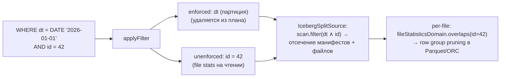

# 10. Статистики и оптимизация запросов к Iceberg

Код: `plugin/trino-iceberg/src/main/java/io/trino/plugin/iceberg/` —
`IcebergStatistics.java`, `TableStatisticsReader.java`, `TableStatisticsWriter.java`,
`IcebergMetadata.applyFilter/getTableProperties/getTablePartitioning`, `IcebergSplitSource.java`.

## 10.1. Какие статистики есть у Trino для Iceberg-таблиц

Источники два:

1. **File-level метрики из манифестов** (без дополнительных файлов): `recordCount`, `columnSizes`,
   `valueCounts`, `nullValueCounts`, `nanValueCounts`, `lowerBounds/upperBounds` на каждый data-файл
   (заполняются writer'ами — `MetricsWrapper`).
2. **Extended statistics** (puffin-файлы статистик): NDV (number of distinct values) в виде
   **DataSketches Theta-скетчей** — blob-тип `APACHE_DATASKETCHES_THETA_V1`.

### TableStatisticsReader (что получает движок)
`Metadata.getTableStatistics` → `TableStatisticsReader.getTableStatistics(handle, projectedColumns, table)`:
- эффективный предикат = `enforcedPredicate ∩ unenforcedPredicate`; если `none` — rowCount 0;
- манифесты фильтруются библиотечным `ManifestEvaluator.forRowFilter(...)` по partition-сводкам;
- чтение манифестов (колонки `partition, file_path, column_sizes, value_counts, null_value_counts,
  nan_value_counts, lower_bounds, upper_bounds, record_count`); до `INLINE_MANIFEST_DECODE_THRESHOLD = 4`
  манифестов читаются inline, дальше — параллельно на `@ForIcebergPlanning`;
- агрегация в `IcebergStatistics.Builder`: `recordCount` (сумма по файлам), min/max через
  `TypeOperators.getComparisonUnorderedLastOperator`, для identity-партиций min/max из значения
  партиции; **row count берётся суммированием по файлам, а не из snapshot summary**;
- итог: rowCount, `nullsFraction`, `DoubleRange` из min/max, NDV из puffin, dataSize
  (VARCHAR — размер на диске × 2.7, VARBINARY × 1.4 — эмпирические коэффициенты).

### ANALYZE
- `getStatisticsCollectionMetadata`: только скалярные не-hidden колонки; собирается `NUMBER_OF_DISTINCT_VALUES` через скрытую агрегатную функцию `$iceberg_theta_stat` (`aggregation/IcebergThetaSketchForStats.java`, `Family.ALPHA` sketches);
- движковый `StatisticsWriterNode` → `finishStatisticsCollection` → `TableStatisticsWriter.writeStatisticsFile(REPLACE)`: puffin `<queryId>-<uuid>.stats`, blob с компрессией ZSTD и свойством `ndv`; регистрация `transaction.updateStatistics().setStatistics(file)`.
- При INSERT/CTAS (`collect_extended_statistics_on_write=true`): режим **INCREMENTAL_UPDATE** — union с предыдущим sketch'ем; для INSERT — только колонки с уже известным NDV.
- `ALTER TABLE ... EXECUTE drop_extended_stats` — `removeStatistics` для всех файлов статистик.
- После OPTIMIZE — `rewriteStatisticsFile` (перепривязка blob'ов к новому снапшоту).

## 10.2. Predicate pushdown и partition pruning

### applyFilter (coordinator, на плане)
`IcebergMetadata.applyFilter` — `UtcConstraintExtractor` → TupleDomain; домены делятся на:

| Категория | Критерий | Судьба |
|---|---|---|
| `newEnforced` | партиционная колонка (identity/transform) присутствует **во всех** спеках снапшота ИЛИ метаданные-колонки `$partition`/`$path`/`$file_modified_time` | удаляется из плана движка (движок не проверяет) |
| `newUnenforced` | конвертируется в Iceberg expression, но не enforced | проверяется коннектором на чтении (file stats) и движком |
| `unsupported` | не конвертируется (например, не-UTC-функции) | остаётся FilterNode движка |

Движок видит `remainingConstraint` = unsupported + unenforced.

### Фактическое отсечение (IcebergSplitSource)
- `effectivePredicate = dataColumnPredicate ∩ unenforcedPredicate ∩ dynamicFilter`;
  `toIcebergExpression` → `tableScan.filter(...)`: **манифесты и файлы отсекает библиотека Iceberg**
  (по partition summaries манифестов и file statistics — внутренние `Inclusive*Evaluator`'s);
- большие IN-листы: `simplify(ICEBERG_IN_PREDICATE_LIMIT = 200)` — выше лимита не пушдаунится
  в Iceberg, но точно матчится в Trino (`fileStatisticsDomain().overlaps(...)`);
- `scan.includeColumnStats(...)` при предикатных колонках — статистики файлов попадают в сплиты
  и на воркер (пересечение с dynamic filter);
- партиционное отсечение: `partitionSpec.partitionToPath(...)` против `partitionDomain` +
  `$path` + `$file_modified_time` (реальный lastModified).

### Discrete predicates и metadata queries
`getTableProperties.discretePredicates` — уникальные значения identity-партиций (из `planFiles()`).
Движковый `MetadataQueryOptimizer` заменяет `SELECT DISTINCT partition_col LIMIT n` /
`min/max(partition_col)` на `ValuesNode` без скана (session `optimize_metadata_queries`).

## 10.3. Dynamic Filtering

- Split source ждёт сборки dynamic filter до `iceberg.dynamic-filtering.wait-timeout = 1s`
  (`getRequestedDynamicFilterWaitTimeoutMillis`);
- готовые домены пушатся в скан (как выше); полностью «пустой» фильтр завершает источник сплитов;
- на воркере домен dynamic filter приходит в `createPageSource` и пересекается с unenforced
  предикатом — отсекаются row groups;
- подробнее о механизме — [04-joins.md, раздел 4.6](04-joins.md).

## 10.4. Bucket execution (co-located сканы и join'ы)

- `getTablePartitioning`: включён `bucket_execution_enabled=true` (default), таблица партиционирована
  и **ровно одна партиционная спека** → `IcebergTablePartitioning(active=false, IcebergPartitioningHandle.create(spec, typeManager), partitionColumns)`;
- `applyPartitioning` (вызывается движком при `DetermineTableScanNodePartitioning`/`AddExchanges`):
  активирует partitioning, только если запрошенные колонки ⊆ партиционных; value-based
  (не-BUCKET) трансформы отбрасываются;
- активный partitioning → `getTableProperties().getTablePartitioning()` → движок строит сплиты
  по бакетам (`NodePartitioningManager` + `IcebergNodePartitioningProvider.getBucketNodeMapping`)
  и может join'ить co-located (без repartition), либо репартицировать запись по бакетам;
- bucket-функции: `IcebergBucketFunction` (значения transform для распределения),
  `IcebergUpdateBucketFunction` (hash(file path) — для row-level update).

## 10.5. Остальные оптимизации

- **Projection pushdown** (`applyProjection`): простые колонки + dereference-цепочки (row-типы) —
  в handle попадают `projectedColumns` с path из field id; `Scan.project(TypeUtil.select(...))` —
  Iceberg-скан читает только нужные поля (включая вложенные в Parquet/ORC).
- **Limit pushdown** (`applyLimit`): только если `unenforcedPredicate.isAll()`.
- **Parallel planning**: манифесты читаются пулами `@ForIcebergSplitManager` /
  `@ForIcebergPlanning` (`iceberg.split-manager-threads`, `iceberg.metadata.parallelism=8`).
- **`query_partition_filter_required`**: `validateScan` требует фильтр по партиционной колонке
  (config + перечисление схем); `constraintColumns` из applyFilter.
- **Split weighting**: вес сплита учитывает позиционные делеты (×2) и equality deletes —
  планировщик движка балансирует нагрузку (см. [08, раздел 8.2](08-iceberg-read-path.md)).
