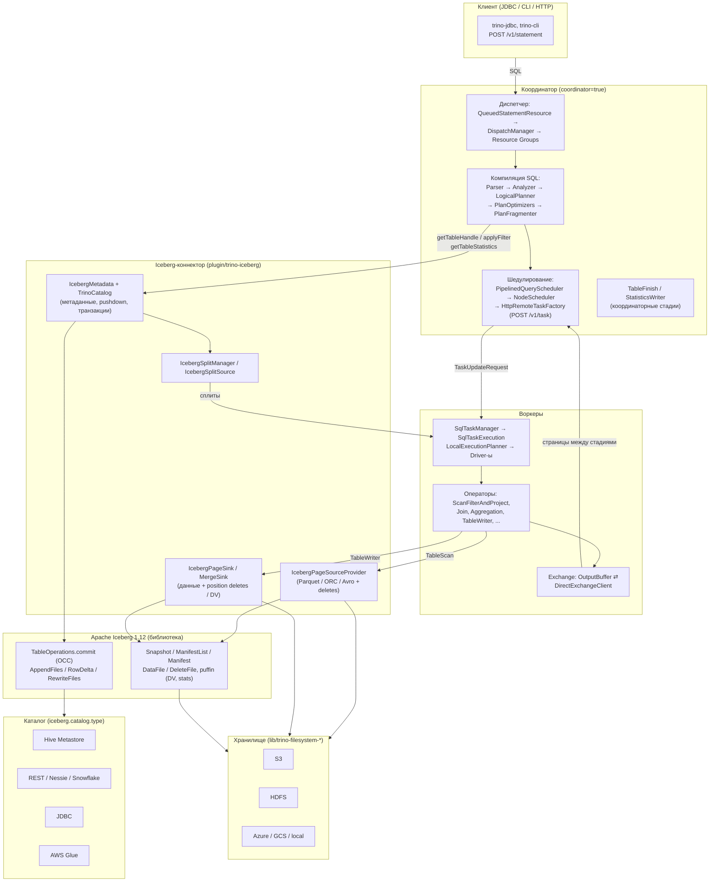

# Trino Engine + Iceberg: документация по внутреннему устройству

Этот раздел — результат глубокого исследования кодовой базы Trino (данный форк, коммит `e112ffd`),
с фокусом на интеграцию с таблицами формата **Apache Iceberg** (в репозитории используется
библиотека `org.apache.iceberg` версии **1.12.0**, см. `pom.xml`, свойство `dep.iceberg.version`).

Документы описывают, как устроен движок Trino и как каждый его слой взаимодействует
с Iceberg-коннектором: от приёма SQL-запроса координатором до чтения Parquet-файлов из S3
и коммита нового снапшота таблицы.

## Карта документов

| # | Документ | Содержание |
|---|----------|-----------|
| 1 | [01-trino-architecture.md](01-trino-architecture.md) | Общая архитектура: координатор/воркер, запуск сервера, discovery, плагины, каталоги, сессии, транзакции, безопасность |
| 2 | [02-query-lifecycle.md](02-query-lifecycle.md) | Жизненный цикл запроса: парсинг → анализ → логический план → оптимизация → фрагментация → шедулирование |
| 3 | [03-execution-runtime.md](03-execution-runtime.md) | Рантайм выполнения: Page/Block/Type, операторы, драйверы, память, exchange, spilling, кодогенерация |
| 4 | [04-joins.md](04-joins.md) | Выполнение JOIN: выбор стратегии, hash join, nested loop, semi/spatial join, dynamic filtering, spilling |
| 5 | [05-connector-spi.md](05-connector-spi.md) | Connector SPI: как коннекторы (в т.ч. Iceberg) встраиваются в движок |
| 6 | [06-iceberg-connector-overview.md](06-iceberg-connector-overview.md) | Iceberg-коннектор: модули, каталоги (HMS, JDBC, Nessie, REST, Glue, Snowflake), конфигурация |
| 7 | [07-iceberg-metadata-transactions.md](07-iceberg-metadata-transactions.md) | Метаданные Iceberg: IcebergMetadata, handle'ы, транзакции коннектора, commit protocol (OCC), таблицы, скрытые колонки |
| 8 | [08-iceberg-read-path.md](08-iceberg-read-path.md) | Путь чтения: scan tasks → сплиты → page sources, ORC/Parquet/Avro, delete-файлы и deletion vectors, кэширование |
| 9 | [09-iceberg-write-path.md](09-iceberg-write-path.md) | Путь записи: INSERT/CTAS/UPDATE/DELETE/MERGE, файловые writer'ы, RowDelta, deletion vectors, OPTIMIZE, materialized views |
| 10 | [10-iceberg-statistics-optimization.md](10-iceberg-statistics-optimization.md) | Статистики (ANALYZE, theta-sketch), partition pruning, predicate pushdown, dynamic filtering, bucket execution |
| 11 | [11-iceberg-maintenance.md](11-iceberg-maintenance.md) | Обслуживание: процедуры (optimize, expire_snapshots, ...), ALTER TABLE, системные таблицы ($files, $snapshots, ...) |
| 12 | [12-storage-filesystem.md](12-storage-filesystem.md) | Хранилище: TrinoFileSystem, S3/GCS/Azure/HDFS, blob-кэш, object store layout, FileIO |
| — | [RESEARCH-PLAN.md](RESEARCH-PLAN.md) | План исследования (черновик процесса) |

## Слои решения (общая картина)

Ключевая идея: **движок ничего не знает про Iceberg** — он работает с коннектором через
Connector SPI (метаданные, сплиты, page sources/sinks, partitioning). Вся Iceberg-специфика
(снапшоты, манифесты, delete-файлы, commit-протокол) инкапсулирована в `plugin/trino-iceberg`
и библиотеке Apache Iceberg; доступ к файлам — через единый стек `lib/trino-filesystem*`.

## Как читать документацию

- Документы 01–04 — устройство движка (без привязки к Iceberg, но с указанием точек стыковки).
- Документы 05–12 — Iceberg-интеграция по нарастающей: SPI → коннектор → метаданные → чтение → запись → оптимизация → обслуживание → хранилище.
- Все ссылки на код — относительные пути от корня репозитория, например
  `plugin/trino-iceberg/src/main/java/io/trino/plugin/iceberg/IcebergMetadata.java` (далее сокращается до `.../iceberg/IcebergMetadata.java`).
- Документация основана исключительно на чтении кода; классы и методы, упомянутые в тексте,
  существуют в этом форке (проверено). Отличия от «классических» описаний Trino старых версий
  оговариваются отдельно (код активно меняется: например, merge join в этой версии отсутствует,
  `LazyBlock` удалён и т.д.).

## Подраздел: smj-research — исследования для реализации Sorted Merge Join

В Trino нет sorted merge join — все equi-join выполняются hash join'ом, что ограничивает
масштабируемость на десятках млрд строк (build-сторона + spilling). Подраздел
[`smj-research/`](smj-research/README.md) содержит подготовительные исследования для реализации SMJ:

- глубокое погружение во внутренности JOIN-подсистемы и существующие сортировочно-merge механизмы;
- полную карту точек интеграции в planner/optimizer/runtime (включая модель sortedness и Iceberg sort order);
- обзор реализаций SMJ в Spark / ClickHouse / DuckDB / Velox / PrestoDB (включая реальные PR);
- brainstorm пяти ролей (java developer / java architect / perf-инженер / MPP-архитектор / trino-коммиттер);
- **синтез с рекомендуемой архитектурой и roadmap** — [`smj-research/10-synthesis-and-recommendations.md`](smj-research/10-synthesis-and-recommendations.md).

## Подраздел: smj-plan-dev — план реализации Sorted Merge Join

[`smj-plan-dev/`](smj-plan-dev/README.md) — детальный план разработки на основе всех исследований
(каждый этап кросс-проверен против документов `ai-docs/`):

- **единый план** (архитектурные решения A1-A10, карта этапов 0-7, сквозные инварианты,
  опорные точки интеграции с верифицированными якорями кода) — [`smj-plan-dev/README.md`](smj-plan-dev/README.md);
- **этапы** — [`smj-plan-dev/stages/`](smj-plan-dev/README.md#7-индекс-этапов): 0 Iceberg
  sortedness; 1 план-модель `JoinNode.algorithm`; 2 оператор `join.merge`; 3 правило
  `DetermineJoinAlgorithm` + гварды; 4 обмены + e2e (MVP); 5 спилл + RIGHT/FULL + multi-driver;
  6 partitioned merging + CBO; 7 полная интеграция.
