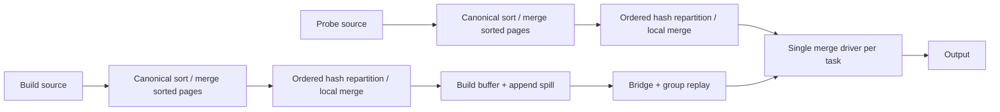

# Проверка концепции и архитектуры

> Историческое состояние до исправлений: `773afdee3bd`. Текущие изменения и результаты проверок: [IMPLEMENTATION_RESULTS.md](IMPLEMENTATION_RESULTS.md), [IMPLEMENTATION_CHECKLIST.md](IMPLEMENTATION_CHECKLIST.md).

Аудируемый HEAD: `773afdee3bd`. Выводы ниже относятся к фактическому коду этой ветки, а не к будущему идеальному SMJ.

## 1. Концепция решает реальную, но ограниченную задачу

Equi-join можно исполнять без удержания целой hash-таблицы: совместимо распределить строки по ключам, отсортировать входы внутри задач и выполнять merge. Совпадающие ключи образуют группы; большая группа требует повторяемого внешнего хранилища и ограниченного по памяти обхода. Сам merge-loop без такого хранилища не решает проблему skew или build больше RAM.

В этой ветке нужные составляющие действительно присутствуют. Поэтому идея не опровергнута найденными дефектами и не требует отказа от SMJ как класса алгоритмов. Но свойство «существует spill» слабее свойства «работа и I/O масштабируются предсказуемо»; V02-04 показывает это на реальном коде.

Официальная документация Trino описывает ограничение hash-spill: обработка требует загрузить отдельную build-партицию; большая неделимая партиция остаётся проблемой. Таким образом, внешнее обслуживание большой группы может дать самостоятельную ресурсную пользу. При этом upstream называет legacy spill устаревающим направлением и рекомендует рассмотреть TASK retries с exchange manager. Это нужно учитывать в обосновании MR, не выдавая SMJ при retry NONE за замену FTE. [Trino: Spill to disk](https://trino.io/docs/current/admin/spill.html).

## 2. Фактическая физическая схема

Это основной путь с ordered remote repartition. При уже совместимой colocation сортировка может выполняться непосредственно в join stage. Частичные сортировки и LOCAL merge обеспечивают порядок до отправки; hash partitioning сохраняет относительный порядок выбранных строк, а remote MergeOperator объединяет отсортированные потоки отправителей.

| Инвариант | Что делает код | Оценка |
|---|---|---|
| Равные ключи попадают в совместимые задачи | AddExchanges сначала строит совместимое partitioning, сохраняет исходный PartitioningScheme | Подход корректен; один hot key всё равно остаётся в одной задаче |
| Одинаковый полный порядок equi-ключей | ASC NULLS LAST на обеих сторонах | Обосновано для допущенных scalar types; повторяющиеся символы ломают построение схемы, V02-03 |
| Task stream действительно отсортирован | SortNode, partial sorts, LOCAL/REMOTE merge; repartition до сортировки | Основной путь обоснован; stage topology надо сохранять при всех последующих rewrites |
| compare==0 согласовано с SQL equality | DOUBLE/REAL/ROW/ARRAY исключены из eligibility, top-level NULL не матчится | Консервативный и разумный scope; не заявлять поддержку всех orderable types |
| Дубликаты не теряются при продолжении страниц | Состояние probe row и build group хранится между вызовами | Прежние дефекты покрыты проходящими тестами |
| Вся большая группа не нужна в RAM | Append spill, ограниченный replay cache, probe chunks, group-local disk bitmap | Работает функционально; есть серьёзный replay I/O дефект |
| RIGHT/FULL учитывают residual | Матч отмечается только после успешного фильтра, unmatched drain отделён | Направление корректно; нужны дополнительные долгие/yield/lifecycle проверки |
| Завершение/отмена освобождают ресурсы | Bridge reference lifecycle и close spiller/bitmap | Обычные сценарии покрыты; после restart bitmap cleanup неполон |
| Dynamic filter имеет согласованные producer/consumers | INNER собирает домены, RIGHT сохраняет consumers без producer | Нарушение интеграции, воспроизведено в V02-10 |

Однопоточный merge **внутри задачи** не равен глобальному join на одном worker. Распределённый параллелизм есть, но один worker/task не использует `task_concurrency` merge-драйверов. `duplicate()` обеих SMJ-фабрик выбрасывает исключение, AddLocalExchanges требует single stream. Multi-driver merge из исходного stage 5 не реализован.

## 3. Sorted Iceberg files — подсказка, не готовый sorted task stream

File-level `sortOrderId` и identity-prefix достаточны для осторожного вывода о порядке внутри файла, если соблюдён контракт writer. Они не доказывают порядок между файлами, между splits одного файла, поступающими разным drivers, или после обычного hash exchange. Split также не обязан быть целым файлом: IcebergSplitSource использует `FileScanTask.split(...)`; соответствующая предпосылка исходного stage 0 устарела. Континуальный диапазон корректно отсортированного файла при последовательном чтении сам по себе сохраняет порядок.

Текущая реализация безопаснее ранней идеи «просто убрать SortNode»: `OrderByOperator` проверяет порядок каждой полученной страницы и либо объединяет страницы через PagesIndex, либо сортирует обычным способом. Даже при наличии hint данные буферизуются, адресный индекс заполняется, spill и merge runs остаются. Это не streaming fast path без materialization, и не O(n)-путь для произвольного числа страниц.

Следует различать проверяемую подсказку внутри SMJ-сортировки и общий `ConnectorTableProperties.localProperties`. Последний API используют и другие оптимизаторы; его нельзя расширять до обещания порядка всего task stream без анализа consumers. V02 не установил тихого неправильного результата TopN/Window из-за этой ветки, но матрица null/unknown sort IDs уже выявила общую регрессию SELECT (V02-01).

Нужны отдельные проверки mixed sort orders, sort-order evolution, transform-prefix, deletes, больших файлов с несколькими splits и обычных TopN/Window/aggregation при SMJ OFF. Проверка «metadata содержит SortingProperty» не является проверкой всех этих контрактов. [Iceberg: Sorting](https://iceberg.apache.org/spec/#sorting).

## 4. Материализация, память и повторяющиеся группы

Build buffer обслуживает весь отсортированный build-поток, а не только текущую группу. Без spill probe ждёт окончания build; с AppendingSpiller завершённые batches доступны раньше. При этом discovery одной совпадающей группы должен увидеть её конец до replay. Для единственной hot group раннего результата до завершения этой группы ожидать нельзя.

Если `B_k` — объём build-группы, `P_k` — объём probe-группы, `C` — размер probe chunk, то желательная оценка replay включает `sum(B_k * ceil(P_k / C))`, плюс discovery, сортировки и выдачу результата. Many-to-many output имеет неизбежный размер `sum(m_k * n_k)` до residual; сам SMJ не устраняет эту работу. Для фильтра, отклоняющего большинство пар, output мал, но число проверяемых кандидатов может оставаться большим.

V02-04 добавляет нежелательную работу поиска позиции в общем файле. Она возникает даже при одной probe-строке на группу и линейном output, поэтому не объясняется неизбежной many-to-many сложностью. Это основной алгоритмический пробел текущей реализации.

Память лучше описывать как сумму live sort buffers, fan-in readers, build batch/replay pages, probe chunk, matched state, output/serde buffers и metadata. Только часть этих составляющих отражена в текущих task reservations. V02-07 не опровергает ограниченность output buffer, но ограничивает интерпретацию измерений «16 МиБ».

## 5. Цена общего SortingSpiller и границы OFF

SortingSpiller исправляет реальную проблему неограниченного final fan-in: одинаковые уровни сливаются попарно, число живых runs растёт логарифмически, итоговый reader один. Это полезный самостоятельный external-sort primitive.

Компромисс: merge fan-in равен двум; при большом числе runs появляются несколько полных проходов чтения/записи, а не один final k-way merge. Он применяется **ко всем spill-enabled OrderBy**, даже при `prefer_merge_join=OFF`. Сохранение hash-плана не означает нулевую регрессию всей системы. Iceberg sortedness тоже включается отдельным default-true свойством.

До MR нужны отдельные сортировочные benchmarks по числу runs/ширине строк/типу ключа/компрессии и сравнение с базовым Trino. Разумная граница PR — выделить bounded sorter с его собственными tests/benchmarks. Более высокий ограниченный fan-in может оказаться выгоднее, если его reader/page memory явно допускается бюджетом; это предмет измерения, а не предположение об обязательной замене текущей двойки.

## 6. COST_BASED — локальная эвристика после выбора join order/distribution

Положительно: учтены известность stats, bytes/NDV, worker count, colocation, sort/spill/replay, memory pressure, cost margin и неспособность hash unspill рекурсивно делить большую локальную партицию. Малый build и неизвестные stats сохраняют hash. OFF остаётся default.

Ограничения:

- Выбор выполняется после DetermineJoinDistributionType и ReorderJoins. Совместной оптимизации join order + build orientation + distribution + algorithm нет. Это допустимый первый scope, но не полная SMJ-интеграция CBO из stage 6/7.
- `CostCalculatorUsingExchanges.visitJoin():180` и `CostCalculatorWithEstimatedExchanges.visitJoin():127` не различают MERGE. Отдельная модель выбора не делает все последующие EXPLAIN/plan costs SMJ-aware.
- NDV даёт лишь нижнюю оценку концентрации, `max(NDV_i)` не описывает корреляцию составных ключей и частоты hot keys. Средняя группа не доказывает максимальную стоимость replay или достаточность памяти.
- Дисковый I/O добавляется к CPU в байтовых единицах; его реальная цена зависит от storage, компрессии и конкуренции. Модель не отражает V02-04 и single-driver bottleneck.
- `memoryLimit/2`, `PAGE_ROWS=1024`, фиксированные overhead и пороги — предположения модели. Они не являются runtime admission или гарантией отсутствия OOM при нескольких живых join/sort.

В сохранённой калибровке v01 FORCE медленнее hash в sorted/unsorted/skew; AUTO там оставляет hash. В wide FULL hash не уложился в малый лимит, AUTO выбрал проходящий MERGE. Это свидетельство ресурсной пользы одного сценария, **не доказательство общего ускорения SMJ на sorted Iceberg**. Приёмка TPC-DS — планирование 103 query parts SF-1000 по fixtures; физического выполнения этого объёма данных нет.

Кроме того, `BaseCostBasedPlanTest.generateQueryPlan():258` сравнивает вывод `JoinOrderPrinter`: в нём нет SortNode и ordering scheme exchanges, а обычные residual predicates не печатаются. Равенство этих golden strings полезно для join order/distribution, но не означает byte-for-byte равенства всего физического плана или отдельной проверки stage count. Для доказательства OFF isolation и ordered topology нужен более полный fingerprint/validator.

Для upstream нужно точно назвать режим, например ограниченный экспериментальный выбор для memory-sensitive workloads, и обосновать его реальными sweep-ами: близкие к порогам размеры, несколько workers/tasks на узел, skew, join chains, concurrency, spill bandwidth/capacity и реальные compression ratios.

## 7. FTE и современные execution modes

Гейт `retryPolicy==NONE` корректно не обещает recovery для локальных mutable spill-файлов. Это ограничение текущего scope, а не само по себе ошибка SMJ. Поддержка TASK retries потребует attempt ownership, воспроизведения входов и согласованной публикации результата; одного разрешения ordered exchange в enum недостаточно. [Trino: Fault-tolerant execution](https://trino.io/docs/current/admin/fault-tolerant-execution.html).

Полезно разделить два вопроса к MR: является ли оператор корректным дополнительным методом equi-join и оправдана ли новая значительная инфраструктура legacy-spill в upstream. Первый вопрос можно закрыть кодом и tests; второй требует позиционирования, изоляции изменений и сравнительных данных. Наличие технически допустимого прототипа не предрешает upstream acceptance.

## 8. Статус исходных этапов

| Этап исходного плана | Реальное состояние |
|---|---|
| 0: Iceberg sortedness | Реализован hint и metadata cache; default-path дефект и неполная compatibility matrix |
| 1: JoinNode model | Маркер/основные invariants есть; обнаружен дополнительный marker drop при expression rewrite |
| 2: operator | Основной merge и residual работают; yield/observability требуют доработки |
| 3: strategy/guards | Узкая eligibility обоснована; FORCE/PREFER выбирают любой eligible join; RIGHT dynamic filtering требует исправления |
| 4: exchanges/e2e | Основная ordered topology проверена; repeated equi-symbol ломает FULL |
| 5: spill/RIGHT/FULL/multi-driver | Внешний replay функционален, но есть масштабный I/O дефект; multi-driver отсутствует |
| 6: partitioned merge/CBO | Ordered repartition и отдельная эвристика есть; полного cost integration и нагрузочных gates нет |
| 7: integration | FTE/range/MergePath и полноценная SMJ-aware join enumeration остаются follow-up, не готовыми функциями |

Чеклист устранения замечаний v01 действительно может быть закрыт относительно тех тестов. Это не закрывает все исходные stage acceptance gates и не является сертификатом готовности MR. Новые замечания следует вести отдельно, сохраняя историю v01.
