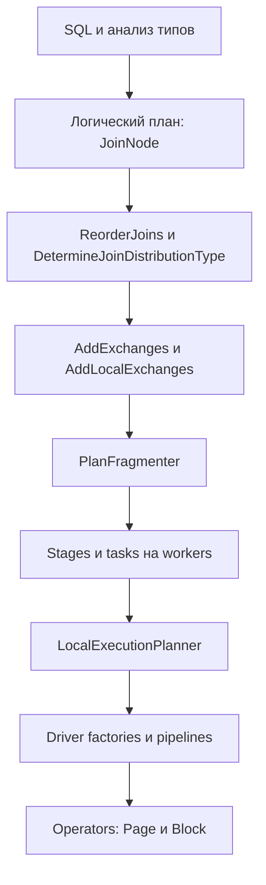

# Архитектура ядра и путь JOIN

Trino — распределённый SQL engine с собственным planner и task execution. Connector обеспечивает metadata, splits и чтение данных, иногда pushdown; общий физический join исполняется в `trino-main`. Для нового общего SMJ основная работа находится в ядре, а connector SPI нужен позднее для доказуемого использования порядка хранения.

Точки входа: [SqlQueryExecution](../../core/trino-main/src/main/java/io/trino/execution/SqlQueryExecution.java), [LogicalPlanner](../../core/trino-main/src/main/java/io/trino/sql/planner/LogicalPlanner.java), [PlanOptimizers](../../core/trino-main/src/main/java/io/trino/sql/planner/PlanOptimizers.java), [PlanFragmenter](../../core/trino-main/src/main/java/io/trino/sql/planner/PlanFragmenter.java), [LocalExecutionPlanner](../../core/trino-main/src/main/java/io/trino/sql/planner/LocalExecutionPlanner.java). Схема показывает уровни ответственности, а не полный порядок всех optimizer passes.

## Логика, стратегия и стоимость

[JoinNode](../../core/trino-main/src/main/java/io/trino/sql/planner/plan/JoinNode.java) хранит тип join, оба child, equi-criteria, дополнительный filter, output symbols, distribution, spillability и dynamic filters. `INNER/LEFT/RIGHT/FULL` описывают семантику. `PARTITIONED/REPLICATED` описывают доставку данных. Ни одно из этих перечислений не означает выбор между hash и merge.

[ReorderJoins](../../core/trino-main/src/main/java/io/trino/sql/planner/iterative/rule/ReorderJoins.java) меняет порядок и ориентацию допустимых joins. [DetermineJoinDistributionType](../../core/trino-main/src/main/java/io/trino/sql/planner/iterative/rule/DetermineJoinDistributionType.java) рассматривает распределения и переворот сторон, использует оценки стоимости и size-based fallback при неизвестных оценках. Для RIGHT/FULL replicated build запрещается, чтобы не размножать unmatched right rows. Автоматический выбор SMJ должен учитывать эти преобразования: ранняя фиксация физического алгоритма может стать неверной после смены детей или ключей.

[CostCalculatorUsingExchanges](../../core/trino-main/src/main/java/io/trino/cost/CostCalculatorUsingExchanges.java), `visitJoin`, и [CostCalculatorWithEstimatedExchanges](../../core/trino-main/src/main/java/io/trino/cost/CostCalculatorWithEstimatedExchanges.java) оценивают CPU, memory и network. Нынешнюю join-cost формулу нельзя считать стоимостью внешнего SMJ: у него сортировка обеих сторон, число merge passes и I/O replay групп. Это отдельное расширение модели, а не одна константа в existing hash cost.

## Распределение и порядок — разные свойства

[AddExchanges](../../core/trino-main/src/main/java/io/trino/sql/planner/optimizations/AddExchanges.java), `visitJoin`, обеспечивает совместимое межузловое распределение ключей или replication. [AddLocalExchanges](../../core/trino-main/src/main/java/io/trino/sql/planner/optimizations/AddLocalExchanges.java), `visitJoin`, готовит локальную многопоточность. Текущий hash join допускает lookup в общем partitioned build из probe drivers; SMJ требует, чтобы каждый merge получил **полные соответствующие потоки одной и той же партиции с обеих сторон**.

`hash(k) mod P` не даёт сортировку по `k`. Сортировка отдельных файлов не даёт сортировку их произвольной конкатенации. Repartition или gather без merge может разрушить входной порядок. Поэтому сортировать нужно после последнего перемешивающего exchange либо явно merge-ить гарантированно упорядоченные upstream streams.

У Trino есть [PropertyDerivations](../../core/trino-main/src/main/java/io/trino/sql/planner/optimizations/PropertyDerivations.java), [StreamPropertyDerivations](../../core/trino-main/src/main/java/io/trino/sql/planner/optimizations/StreamPropertyDerivations.java) и `OrderingScheme`. Они дают основу для контракта local ordering, но не являются готовым proof для нового join. Обычный `SortNode` обслуживает SQL ORDER BY: `visitSort` в exchange planners может добавить merge/gather до одного потока. Вставить такой узел под JOIN без определения partition-local semantics опасно для MPP.

## Исполнение и память

[Driver](../../core/trino-main/src/main/java/io/trino/operator/Driver.java) исполняет цепочку operators кооперативно. Интерфейс [Operator](../../core/trino-main/src/main/java/io/trino/operator/Operator.java) имеет один `addInput(Page)`, `needsInput`, `getOutput`, `finish`, `isBlocked`, memory-revoke hooks и cleanup. Он не является интерфейсом двухвходового merge. Существующий hash join решает эту проблему отдельным build pipeline и bridge.

[Page](../../core/trino-spi/src/main/java/io/trino/spi/Page.java) содержит столбцовые [Block](../../core/trino-spi/src/main/java/io/trino/spi/block/Block.java). Logical bytes и retained bytes различаются: небольшое представление dictionary/region может удерживать крупный backing block. Оператор обязан учитывать фактически удерживаемую память, а не только длину ключей.

[WorkProcessor](../../core/trino-main/src/main/java/io/trino/operator/WorkProcessor.java) поддерживает result/blocked/yield/finished transitions. Это хороший внутренний механизм merge kernel, но существующий adapter нельзя автоматически считать поддерживающим spill lifecycle. Подробный разбор — [роль Java developer](brainstorm/01-java-developer.md).

Вывод для разработки: SMJ затронет planner, свойства плана, обмены, scheduling, ownership памяти и временных файлов. Реализация только в `LocalExecutionPlanner` не покрывает эти контракты.
