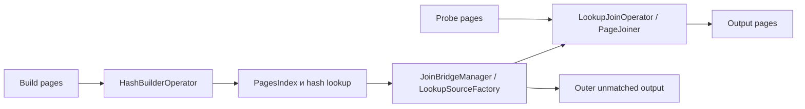

# Как JOIN работает сейчас

## Основной hash path

В [LocalExecutionPlanner](../../core/trino-main/src/main/java/io/trino/sql/planner/LocalExecutionPlanner.java), `visitJoin`, cross join направляется в `createNestedLoopJoin`; остальные обычные `JoinNode` идут в `createLookupJoin`. Левый child здесь probe, правый build; optimizer может предварительно перевернуть стороны.

Build накапливает нужные столбцы, затем создаёт lookup structures. [PagesIndex](../../core/trino-main/src/main/java/io/trino/operator/PagesIndex.java) хранит blocks и адреса позиций; [JoinHashSupplier](../../core/trino-main/src/main/java/io/trino/operator/join/JoinHashSupplier.java) строит [JoinHash](../../core/trino-main/src/main/java/io/trino/operator/join/JoinHash.java), [DefaultPagesHash](../../core/trino-main/src/main/java/io/trino/operator/join/DefaultPagesHash.java) либо bigint specialization. Хеш-таблица содержит дополнительную память сверх собственно данных. Duplicate links позволяют получить несколько build matches для одной probe row.

[JoinBridgeManager](../../core/trino-main/src/main/java/io/trino/operator/join/JoinBridgeManager.java) координирует жизненный цикл build/probe и outer processing. [LookupSource](../../core/trino-main/src/main/java/io/trino/operator/join/LookupSource.java) предоставляет поиск позиции, следующего совпадения, проверку eligibility и append результатов. Это random lookup API, а не sorted cursor API; превращать его в SMJ storage означало бы смешивать разные контракты.

Есть две основные реализации: [nonspilling](../../core/trino-main/src/main/java/io/trino/operator/join/nonspilling/LookupJoinOperator.java) и [spilling](../../core/trino-main/src/main/java/io/trino/operator/join/spilling/LookupJoinOperator.java), с соответствующими `HashBuilderOperator` и `PartitionedLookupSourceFactory`. Выбор `useSpillingJoinOperator` зависит от разрешённого spill либо `force_spilling_join`; принудительный выбор класса **не равен** фактическому разрешению spill.

Probe читает страницу, вычисляет hash/key lookup, перебирает candidates, применяет residual predicate, формирует output pages и сохраняет позицию при yield/заполнении output. [DefaultPageJoiner](../../core/trino-main/src/main/java/io/trino/operator/join/DefaultPageJoiner.java) и специализированные `PageJoiner` показывают необходимые для SMJ patterns остановки/возобновления. Для RIGHT/FULL требуется учёт посещённых build rows и выдача unmatched через [LookupOuterOperator](../../core/trino-main/src/main/java/io/trino/operator/join/LookupOuterOperator.java).

## Оптимизации, которые SMJ должен учитывать

| Механизм | Что даёт сейчас | Следствие для SMJ |
|---|---|---|
| Projection/filter pushdown | Уменьшает build и сеть до JOIN | Сортировать только реально нужные ключи и payload |
| Broadcast малого build | Убирает shuffle большого probe | SMJ может проиграть из-за ненужной сортировки |
| Partitioned join | Распределяет build по workers | Можно использовать то же hash distribution, но нужны paired local streams |
| Generated hash/equality/filter code | Ускоряет inner loops | Переиспользовать семантику type operators; comparator не заменяет equality |
| Dynamic filtering | Отбрасывает probe rows/splits по build keys | Сохранять только безопасные для join semantics фильтры и проверять зависимости ожиданий |
| Output duplicate-insensitivity | Позволяет прекратить часть поиска | Не переносить в произвольный many-to-many join |
| SortedPositionLinks | Ускоряет некоторые inequality predicates внутри hash matches | Это не sort-merge join двух входов |

Последний пункт важен: [SortExpressionExtractor](../../core/trino-main/src/main/java/io/trino/sql/planner/SortExpressionExtractor.java) извлекает сортируемое выражение из join filter, а [SortedPositionLinks](../../core/trino-main/src/main/java/io/trino/operator/join/SortedPositionLinks.java) ускоряет поиск внутри структуры build. Полная hash-table остаётся; внешний streaming merge не появляется.

[DynamicFilterSourceOperator](../../core/trino-main/src/main/java/io/trino/operator/DynamicFilterSourceOperator.java) собирает фильтры по build. В `createLookupJoin` локально потребляемые dynamic filters могут включать `waitForBuild`. В streaming SMJ ожидание полного build и bounded buffering образуют новый граф зависимостей; переносить wait flag механически нельзя.

## Что не является general-purpose hash equijoin

- [NestedLoopJoinOperator](../../core/trino-main/src/main/java/io/trino/operator/join/NestedLoopJoinOperator.java) и build bridge обслуживают cross product.
- [HashSemiJoinOperator](../../core/trino-main/src/main/java/io/trino/operator/HashSemiJoinOperator.java) и `SetBuilderOperator` обслуживают semi/IN-related планы; SQL three-valued logic требует отдельного рассмотрения.
- [IndexJoinNode](../../core/trino-main/src/main/java/io/trino/sql/planner/plan/IndexJoinNode.java) использует index lookup infrastructure. В local planner для него выбран spilling-capable lookup class, поскольку nonspilling implementation не поддерживает index lookup sources; это не доказательство disk spill для index join.
- [SpatialJoinOperator](../../core/trino-main/src/main/java/io/trino/operator/SpatialJoinOperator.java) использует пространственный индекс.
- [PushJoinIntoTableScan](../../core/trino-main/src/main/java/io/trino/sql/planner/iterative/rule/PushJoinIntoTableScan.java) может передать JOIN connector-у. Тогда алгоритм удалённой БД не становится native алгоритмом Trino.

Таким образом, утверждение «в Trino есть только Hash Join» буквально неверно. Верная постановка: **в исследованном ядре отсутствует общий физический equijoin operator, который соединяет два отсортированных потока с внешней обработкой данных**.
