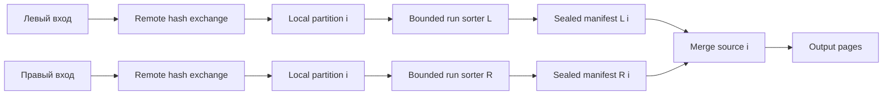

# Предлагаемая архитектура SMJ в Trino

Весь раздел — **проект**, не описание уже существующего API. Рекомендованный первый интегрированный вариант: явный выбор алгоритма в planner, hash repartition обеих сторон, bounded partition-local sort, bridge завершённых run manifests и source-подобный merge operator. Сам `Driver` сохраняет текущий одно-входовый интерфейс.

## ADR 1: представление алгоритма

| Вариант | Преимущество | Цена | Решение для первого MVP |
|---|---|---|---|
| Выбирать SMJ только в LocalExecutionPlanner | Малое локальное изменение | Поздно задавать distribution/order; EXPLAIN и cost не отражают выбор | Отклонить |
| Новое поле algorithm в JoinNode | Сохраняет существующие traversals и join semantics | Все copy/flip и hash-specific rules требуют аудита | Рекомендовать с обязательным validator |
| Отдельный SortedMergeJoinNode | Явно изолирует physical semantics | Новый visitor surface, JSON subtype, stats/cost, DF, scheduler и UI traversal | Сохранить как долгосрочную альтернативу |

Предлагаемое поле `JoinAlgorithm` и enum values ещё не существуют. Логический SQL join type и distribution остаются независимыми осями. Выбор алгоритма фиксируется до построения нужных exchanges, после основных logical transformations; downstream rewrites обязаны сохранять или инвалидировать physical contract. В текущем planner нет абсолютной границы «после неё logical rewrites отсутствуют».

Минимальный audit: [JoinNode](../../core/trino-main/src/main/java/io/trino/sql/planner/plan/JoinNode.java), [PlanOptimizers](../../core/trino-main/src/main/java/io/trino/sql/planner/PlanOptimizers.java), [UseNonPartitionedJoinLookupSource](../../core/trino-main/src/main/java/io/trino/sql/planner/iterative/rule/UseNonPartitionedJoinLookupSource.java), [AdaptiveReorderPartitionedJoin](../../core/trino-main/src/main/java/io/trino/sql/planner/iterative/rule/AdaptiveReorderPartitionedJoin.java), symbol remapping, pruning, partial aggregation, plan serialization и EXPLAIN. Первое из названных rules может заменить build repartition на gather уже после local exchanges; второе переписывает local exchange topology при adaptive flip. До SMJ-aware реализации они должны исключать SMJ.

Финальный validator проверяет контракт после всех rewrites, а также после adaptive replanning. Инвалидирование требует повторного physical planning/enforcement до исполнения либо явного отказа forced mode: простого сброса algorithm недостаточно, поскольку остаются exchanges, sorting и изменения dynamic filters. Validator обнаруживает проблему, но не исправляет план. Он также не доказывает динамическую монотонность произвольного connector stream: в MVP он подтверждает наличие собственной сортирующей стадии и отсутствие последующего перемешивания. В тестовом режиме runtime monotonicity assertions помогут обнаружить ошибки wiring.

## ADR 2: распределение и сортировка



Парность требует совпадения ключей после coercions, hash function, partition count, bucket mapping и назначения partitions tasks/drivers. Одинаковое число drivers само по себе недостаточно. При нескольких upstream runs на входе join cursor сначала выполняет k-way merge, а не конкатенацию.

В MVP сортировка является частью собственного producer pipeline для каждой локальной join partition. Её требования и наличие должны быть видны в physical description/EXPLAIN; она не выражается обычным SQL `SortNode`, который может вызвать gather. Позднее можно вынести её в общий reusable partition-local sort node с явно определёнными свойствами.

Storage sort reuse в MVP отсутствует. Включать его следует только при доказанном порядке полного потока после scan/exchanges. Префикс composite ordering можно использовать, если он покрывает требуемые join keys в согласованном порядке; произвольная перестановка ключей требует перестройки обоих requirements и проверки coercions.

## ADR 3: manifests вместо streaming queues на первом этапе

Оба producer pipelines создают bounded runs и публикуют immutable handles после завершения записи. Bridge сопоставляет `(join, task attempt, local partition, side)` и готовность входов. Барьер относится к конкретной паре partitions; обязательного cluster-wide барьера не требуется.

В manifest находятся descriptors, а не все input pages. Число in-memory descriptors ограничивается online compaction с отдельным resident-metadata budget или дисковым manifest; рост числа уровней compaction тоже учитывается. К финальному чтению каждая сторона предоставляет не более `F` runs, после чего final k-way merge может напрямую питать SMJ. Финальная запись одного большого sorted file необязательна.

Это позволяет producer завершить ingestion без потребления output join, пока соблюдаются disk quotas. Но memory-only run нельзя безусловно удерживать до прихода второй стороны: первая сторона может занять память, необходимую второй. До публикации нужен spill/release либо гарантированный минимальный резерв обеим сторонам. На исчерпание disk quota — понятная ошибка с cleanup, а не бесконечное ожидание освобождения диска consumer-ом, который ещё не может стартовать.

Существующий [PhasedExecutionSchedule](../../core/trino-main/src/main/java/io/trino/execution/scheduler/policy/PhasedExecutionSchedule.java) содержит build→probe dependencies и механизм разблокировки stages при заполнении output buffers. Поэтому deadlock нового streaming transport — риск для проверки, не утверждение о неизбежном deadlock текущего Trino. Materialized manifests уменьшают этот риск; они не освобождают от scheduler tests, особенно для nested joins.

Presorted streaming через две bounded queues — следующий этап после проверки progress. Новый binary `Operator`/`Driver` API для MVP не требуется. Подробное сравнение вариантов: [Java developer](brainstorm/01-java-developer.md), [MPP architect](brainstorm/04-mpp-architect.md).

## Новые компоненты и контракты

Имена ниже рабочие и требуют отдельного review:

| Компонент | Контракт |
|---|---|
| `SortedInputRequirements` | Key types, channels, direction, null ordering, partition identity |
| `PartitionRunSorter` | Bounded run generation, multipass merge, ограничение readers и metadata |
| `SortedRunStore` | Attempt-owned run descriptors, чтение, удаление, accounting |
| `MergeJoinBridge` | Публикация обоих manifests, readiness, failure/cancel propagation |
| `SortedMergeJoinOperator` | Source-like shell, блокировка/yield/revoke/cleanup через Operator |
| `MergeJoinKernel` | Сравнение cursors, группы кандидатов, equality/residual и output |
| `ReplayableGroupStore` | `append`, `seal`, repeated `openCursor`, bounded RAM и число readers |
| `MergeJoinRequirementsValidator` | Проверка плановых distribution/order/eligibility invariants |

`MergeSortedPages`, `PagesIndex`, type operators, page serde и memory contexts — строительные блоки. `LookupSource` не используется как sorted storage API. `SingleStreamSpiller` может участвовать в одноразовом чтении runs, но не обещает replay групп. `WorkProcessor` подходит для ядра; spill-aware shell должен сам корректно реализовать memory-revoke lifecycle.

Дополнительный Java-audit расширил источники reuse: `SortingFileWriter.combineFiles` в Hive уже реализует bounded fan-in с объединением небольших runs, а Iceberg использует этот writer. Scheduling policy можно обобщить, но FileWriter commit/rollback нельзя механически перенести в Operator; нужен resumable merge и полный resource accounting. См. [13](13-java-sorting-algorithms-and-code.md) и [15](15-bounded-java-sort-design-and-experiments.md).

## State machine и I/O

```text
WAIT_FOR_MANIFESTS -> OPEN_SORTED_INPUTS -> ALIGN_KEYS
ALIGN_KEYS -> ADVANCE_LEFT | ADVANCE_RIGHT | CAPTURE_RIGHT_GROUP
CAPTURE_RIGHT_GROUP -> SEAL_GROUP -> REPLAY_FOR_LEFT
REPLAY_FOR_LEFT -> OUTPUT_PAGE | NEXT_LEFT_IN_GROUP | CLOSE_GROUP
CLOSE_GROUP -> ALIGN_KEYS
EOF -> DRAIN_PRESERVED_SIDE | FINISHED
ANY_STATE -> FAILED/CANCELLED -> CLOSED
```

Каждый переход сохраняет page positions, текущий key bookmark, replay position и matched flag. `OUTPUT_PAGE` означает yield результата, затем продолжение прежнего состояния, а не перезапуск группы. Во всех длительных циклах проверяется cooperative yield, включая residual FALSE и отсутствие совпадений. I/O завершение сигнализируется future; context updates выполняются в разрешённом потоке. Оборачивание blocking iterator в `WorkProcessor` само по себе не делает чтение асинхронным.

В первой реализации INNER с BIGINT и ordinary equality проверяет ключ и residual отдельно; LEFT добавляется после подтверждения matched-state. RIGHT можно позднее реализовать проверенным преобразованием сторон, но FULL требует отдельного matched-state. ANTI/SEMI/null-safe equality не включаются автоматически.

## Бюджет памяти и диска

```text
M_task = M_other + M_exchange
       + Σ_active_instances(M_sort_L + M_sort_R + M_merge_readers
                            + M_group + M_replay + M_output + M_metadata)
```

Бюджет задаётся совместно для фаз; нельзя разрешить каждому sorter и group store независимо занять весь task budget. Минимальный non-revocable reserve нужен для продвижения курсоров, сериализации и записи spill. Revocation не должен требовать дополнительного объёма памяти, который доступен только после завершения самого revoke.

Peak disk включает initial runs, старые и новые runs во время multipass, group store и concurrent tasks. Загрузка из FTE exchange добавляет ещё один вид materialization. Закрытие store освобождает readers, файлы, encryption state и memory reservations; отмена в любой фазе должна быть idempotent.

## Dynamic filters, FTE и fallback

Первый integrated MVP согласованно удаляет producers и consumers dynamic filters, принадлежащие выбранному SMJ, сохраняя фильтры других joins. Просто не создать collector недостаточно: scan может ждать producer, которого больше нет. Позднее bounded key-domain collection можно делать во время ingestion, если сохранены outer semantics и progress.

Для первоначального MVP `RetryPolicy.TASK` не допускается. Forced mode выдаёт явную причину unsupported; automatic mode сохраняет существующий план. Включение TASK — отдельный milestone: runs/group files принадлежат attempt, пересоздаются при retry из exchange inputs, output commit следует существующему механизму. Никаких local paths в качестве durable recovery handles.

Fallback выбирается **до исполнения** и до выдачи output: unsupported types, join semantics, retries или отсутствующие storage capabilities. После начала вывода нельзя просто перезапустить join другим алгоритмом без discard/replay protocol, иначе возможны повторы. Adaptive выбор допустим позднее на границах ещё не исполнявшихся stages.

## Что должно показывать EXPLAIN

Предлагается отображать algorithm, distribution, join keys, supported semantics, local partitioning, необходимость sorting обеих сторон и причину отказа от SMJ. Runtime metrics должны разделять sort spill, group spill, merge passes и replay bytes. Имена свойств/метрик пока не являются API. Публичный session property вводится отдельным изменением с соблюдением [правил конфигурации](../../.github/DEVELOPMENT.md#configuration-and-session-properties).
