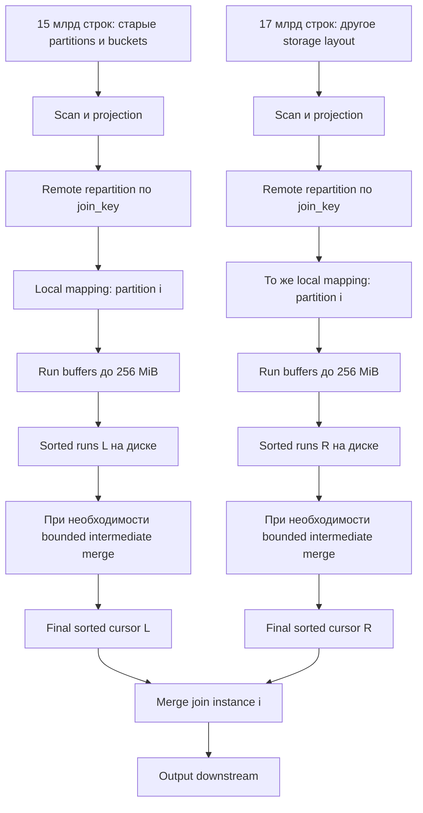

# Разбор: 15 млрд × 17 млрд неотсортированных строк

Это **проектный сценарий Java SMJ**, а не описание уже доступного плана Trino и не benchmark. Разбирается equijoin по произвольному orderable ключу, не совпадающему со storage partitioning/bucketing. Исходные данные не отсортированы. Для базового расчёта считаем, что все 15 и 17 млрд строк остаются после допустимых фильтров; реальный pruning уменьшает объём.

Краткий ответ: таблицы целиком в RAM не загружаются. После shuffle по JOIN key каждый worker сортирует ограниченные portions своего input, записывает sorted runs, выполняет при необходимости промежуточные merge passes и подаёт два отсортированных курсора в local join. Общая таблица никогда не собирается в один глобально отсортированный поток.

## 1. Что нужно знать помимо row count

Запрос вида:

```sql
SELECT l.join_key, l.payload_left, r.payload_right
FROM left_table l
JOIN right_table r ON l.join_key = r.join_key;
```

не определяет стоимость по двум row counts. Нужны key type, projected payload width, NDV/frequency distribution, output multiplicity, residual conditions, memory/disk/network и степень параллелизма. Далее задана явная модель, чтобы числа можно было пересчитать.

| Параметр базового примера | Принятое значение |
|---|---|
| Rows L / R | 15 000 000 000 / 17 000 000 000 |
| Key | BIGINT, ordinary equality; для объёмного расчёта без NULL |
| Projected serialized row | 64 байта с каждой стороны, включая нужные JOIN/output columns |
| Resident row в run buffer | 80 байт: условные 64 payload + 8 address + 8 усреднённый overhead |
| Workers | 64 |
| Remote owners | Условно один owner/task на worker; реальный planner может выбрать иначе |
| Local paired partitions на owner | 8, эффективно равномерных |
| Всего join instances/пар partitions `P` | 512 |
| Run resident budget `B` | 256 MiB на один sorter, scratch и I/O зарезервированы отдельно |
| Fan-in `F` | До 16 runs на один final merge одной стороны |
| Compression | Для арифметики 1:1 |
| Storage режима | Initial runs записываются; final merge streamed непосредственно в join |

80 байт resident на строку — **допущение**, не измеренная константа PagesIndex. Dictionary/lazy blocks, backing buffers, variable-width data, array capacity и transient copies могут существенно изменить значение. 64 байта на диске также не выводятся из схемы автоматически. Отдельно различаются source compressed bytes, wire bytes, compact payload bytes, resident bytes и temporary-file bytes.

## 2. Полный execution graph



Шаги на workers выполняются параллельно и могут перекрываться между независимыми instances. Для несортированного input сортировщик не может выдать гарантированно минимальную строку до конца своей входной partition: в последней page может прийти меньший key. После формирования всех runs final merge уже потоковый. Поэтому SMJ не следует обещать низкую first-row latency на двух полностью unsorted входах.

### Доставка данных

Оба scan читают любые выбранные storage partitions. После coercion join key вычисляется один раз и используется для routing. Старые bucket labels не используются для локального соединения, если их совместимость с новым key не доказана. Remote exchange доставляет equal keys одному owner; local hash дополнительно распределяет их по восьми paired instances. Local hash должен иметь корректное mixing относительно remote hash — существующий `LocalPartitionGenerator` это учитывает, см. [12](12-layout-bucketing-and-repartitioning.md).

Это не `15 млрд` независимых probe lookups в одной hash table на `17 млрд` entries. Это 512 отдельных sorting/merge задач. Даже если одна такая задача больше RAM, она всё равно разбивается на runs. Число partitions выбирается ради параллелизма, memory/I/O overhead и skew; оно не обязано обеспечивать fit всей partition в RAM.

### Run generation

1. Producer принимает Page, проверяет свободный бюджет **с учётом следующей page и transient allocations**.
2. Когда budget исчерпан, сортирует bounded PagesIndex по join key.
3. Читает sorted permutation и сериализует полные projected rows в sequential run pages.
4. Дожидается завершения записи через blocked future, освобождает pages/index и принимает следующий batch.
5. По завершении входа сортирует хвост, завершает run manifest и освобождает ingestion reservation.

Новый input нельзя принимать бесконтрольно во время записи предыдущего run. Double buffering возможно только при явном дополнительном бюджете; иначе восемь drivers незаметно удвоят peak RAM. Сортировка проводится по key, payload переставляется вместе с ним. Original Parquet row pointer не является универсальным устойчивым указателем после scan/shuffle.

## 3. Сколько данных приходится на каждый instance

Все TB здесь десятичные; GiB = 2³⁰ байт.

| Метрика | Left | Right | Сумма |
|---|---:|---:|---:|
| Projected data всего | 0,960 TB | 1,088 TB | **2,048 TB** |
| Rows одной из 512 partitions | 29 296 875 | 33 203 125 | 62 500 000 |
| Payload одной partition | 1,746 GiB | 1,979 GiB | 3,725 GiB |
| Payload на worker, 8 pairs | 13,970 GiB | 15,832 GiB | 29,802 GiB |

Run capacity в упрощённой row-granular модели:

```text
rowsPerRun = floor(256 * 2^20 / 80) = 3 355 443
payloadPerFullRun ≈ rowsPerRun * 64 ≈ 204,8 MiB
leftRuns  = ceil(29 296 875 / 3 355 443) = 9
rightRuns = ceil(33 203 125 / 3 355 443) = 10
```

На весь кластер около `512*(9+10)=9 728` initial run files в модели «один файл на run». Последние runs неполные. Page boundaries, uneven distribution и actual encoding меняют числа; это capacity estimate, не file-count guarantee.

Поскольку 9 и 10 ≤ fan-in 16, **промежуточный merge pass здесь не нужен**. Final merge читает до девяти левых и десяти правых readers, сравнивает их головы и подаёт pages в JOIN. На диске не появляется ещё одна полная копия финально отсортированных таблиц.

## 4. I/O: считать разные потоки отдельно

Для базового примера sorting temporary I/O:

```text
запись initial runs: 2,048 TB
чтение final merge:  2,048 TB
итого sort temp I/O: 4,096 TB
```

Это **read+write traffic**, не требуемая disk capacity. Исключены source scan, network, group replay, FTE exchanges и output. При записи полностью merged final file перед JOIN добавятся ещё 2,048 TB записи и 2,048 TB чтения. Fused final merge экономит именно эту лишнюю materialization.

Если input размещён равномерно на 64 scan workers и routing destination независим от scan placement, доля межузловых строк около `63/64`. Тогда network payload полного shuffle двух сторон ≈ **2,016 TB** без compression/protocol overhead. Это sent bytes через сеть, их не надо ещё раз удваивать только потому, что receiver их принимает. Если scan читает object storage, его network traffic учитывается отдельно. Colocated layout может уменьшить JOIN shuffle, а cross-rack placement — изменить bottleneck.

На одном worker initial runs занимают около **29,8 GiB** при равномерности, до дополнительных copies/group storage и без compression. Нужен запас под active writes, ещё не удалённые inputs intermediate merges, concurrent queries, skew и retries. При FTE добавляется durable exchange storage; нельзя считать его тем же самым local run file.

Общий peak disk моделируется по времени:

```text
D_peak = max_t(live_sort_runs(t) + intermediate_outputs(t)
               + duplicate_group_store(t) + other_attempts(t)
               + local_exchange_files(t) + materialized_query_output(t))
```

В sequential multipass без retries одновременно живые old+new runs могут приближаться к двум объёмам сортируемых данных, если старый input нельзя удалить до успешного завершения нового output. Это полезный запас для той схемы, но не универсальная верхняя граница всего JOIN: group replay/output/retries добавляют объём.

## 5. Память worker: bounded input, а не fit всей таблицы

При восьми paired instances одновременно могут работать 16 sorter producers. Если каждому разрешён полный run buffer 256 MiB, только их суммарный budget — **4 GiB**. Это число нельзя путать с 256 MiB на весь task.

Пример отдельных резервов для проектирования, **не production configuration**:

| Категория | Условный бюджет на worker |
|---|---:|
| До 16 run buffers | 4 GiB |
| До 2 × 16 readers × 8 instances по 2 MiB | 512 MiB |
| До 8 group buffers по 64 MiB | 512 MiB |
| Exchange/output и bounded I/O queues | 2 GiB |
| Sort/serde scratch и progress reserve | 2 GiB |
| Остальной запас внутри 12 GiB join budget | 3 GiB |

Фазы не всегда достигают максимумов одновременно, но phase-aware controller должен это контролировать. Эти 12 GiB — только условный JOIN budget; остальная JVM, scans, upstream/downstream operators и другие queries требуют памяти отдельно. Если ORC/page reader фактически удерживает больше 2 MiB, таблица должна быть пересчитана.

При завершении первой стороны её in-memory tail нельзя удерживать за счёт бюджета, необходимого второй. Либо tail spill-ится, либо заранее резервируется безопасный общий минимум. При exhausted disk quota запрос заканчивается контролируемой ошибкой, а не зависает в ожидании consumer, который ждёт вторую сторону.

## 6. Широкие строки и число проходов

Используем ту же условную модель: resident bytes = projected bytes + 16, buffer 256 MiB, fan-in 16, uniform distribution. Для spilled runs зададим:

```text
R_s = ceil(ceil(N_s / P) / floor(B / residentBytesPerRow))
p_s = max(1, ceil(log_F(R_s)))
temporaryIO = Σ_s 2 * p_s * N_s * serializedBytesPerRow
```

Это **balanced full-level schedule** с последним streamed merge. `max(1,...)` означает, что даже один run в этой модели записан и прочитан. In-memory retained fast path имел бы другой I/O. Реальный size-aware scheduler способен переписать лишь часть runs и дать меньше traffic; online compaction, compression и uneven sizes также меняют результат.

| Effective pairs `P` | Bytes/row | L/R runs на pair | L/R merge levels | Input TB | Sort temp I/O TB |
|---:|---:|---:|---:|---:|---:|
| 64 | 64 | 70 / 80 | 2 / 2 | 2,048 | 8,192 |
| 128 | 64 | 35 / 40 | 2 / 2 | 2,048 | 8,192 |
| **512** | **64** | **9 / 10** | **1 / 1** | **2,048** | **4,096** |
| 2048 | 64 | 3 / 3 | 1 / 1 | 2,048 | 4,096 |
| 512 | 256 | 30 / 34 | 2 / 2 | 8,192 | 32,768 |
| 2048 | 256 | 8 / 9 | 1 / 1 | 8,192 | 16,384 |
| 512 | 1024 | 114 / 129 | 2 / 2 | 32,768 | 131,072 |
| 64 | 1024 | 909 / 1030 | 3 / 3 | 32,768 | 196,608 |

Полные 16 сценариев сохранены в [CSV](calculations/capacity-model.csv); определения и исключения — в [JSON](calculations/capacity-assumptions.json). Арифметика рассчитана программно; это не запуск Java sorter.

Увеличение `P` снижает объём одной partition и может убрать merge level. Но 2048 partitions не должны означать 2048 одновременно выделенных run buffers: при 64 workers это до 32 pairs на worker, то есть 16 GiB только на два 256 MiB buffers для каждой pair. Нужен admission/activation budget или больше task waves с сохранением inactive input на диске. Такая spill/shuffle topology может добавить I/O, которого нет в таблице. Поэтому «увеличить partitions» не бесплатная оптимизация.

### При фиксированной RAM увеличение concurrency может не уменьшить число runs

Пусть на worker выделено `M` байт именно для run buffers, работают `C` paired instances и оба side buffers одинаковы. Тогда `B≈M/(2C)`, `P=W*C`. Игнорируя округления, runs одной стороны одной partition:

```text
R_s ≈ (N_s / (W*C)) / (B / residentWidth)
    ≈ 2 * N_s * residentWidth / (W*M)
```

`C` сокращается. При fixed workers и общем buffer budget одно лишь увеличение числа одновременных partitions не сокращает merge depth; возрастает overhead читателей/очередей. Проверка на тех же 64 workers и **4 GiB суммарных run buffers на worker**:

| Active pairs на worker | Buffer одной стороны | Всего pairs | L/R runs на pair |
|---:|---:|---:|---:|
| 1 | 2 GiB | 64 | 9 / 10 |
| 8 | 256 MiB | 512 | 9 / 10 |
| 32 | 64 MiB | 2048 | 9 / 10 |

Большие runs могут увеличить latency синхронного sort, маленькие — число files и orchestration overhead; CPU scaling и I/O locality также отличаются. Этот расчёт отделяет настоящий эффект большей общей памяти от эффекта parallelism. Overpartitioning при ограниченном числе **активных** partitions может дать другие tradeoffs, но нуждается в materialized inactive input и его I/O accounting.

Условие одного final merge без intermediate passes при фиксированном `B`:

```text
ceil(N_s/P) <= F * floor(B/residentWidth)   для обеих сторон
```

В рассматриваемой модели минимальные `P` по большей стороне около 317 при 64 payload bytes, 1077 при 256 и 4117 при 1024. Это арифметические пороги при uniform input, не рекомендуемые значения session properties: нужно учитывать mapping, допустимые counts, memory, skew и фактическую granularity runs.

## 7. CPU и нижние оценки времени

Порядок работы run comparison sort для базового случая — `32e9 * log2(3 355 443) ≈ 6,94e11` сравнений, с поправкой на конкретный алгоритм, tails и distributions. Это оценка масштаба, не фактический comparator count. Final heap merge добавляет сравнения порядка `15e9*log2(9) + 17e9*log2(10)`. Key extraction, permutation, payload copying, serde, compression, hashing и JOIN comparisons оплачиваются отдельно.

Даже Java radix для BIGINT может ускорить лишь часть этой работы. Если дополнительный scratch уменьшит rows per run так, что R пересечёт fan-in threshold, local CPU выигрыш может сопровождаться ещё одним disk pass. Нужно оценивать весь pipeline.

Нижняя ресурсная оценка времени:

```text
T >= max(scan_bytes / sustained_scan_bandwidth,
         shuffle_bytes / sustained_network_bandwidth,
         temp_IO_bytes / sustained_mixed_disk_bandwidth,
         CPU_work / sustained_CPU_rate,
         output_bytes / sink_bandwidth)
```

Она не учитывает barrier/stragglers и не означает, что все фазы идеально перекрываются. Например, только 4,096 TB temp traffic при условных 32 GB/s **совокупной измеренной mixed read/write** bandwidth потребуют не меньше 128 секунд. При 8 GB/s — не меньше 512 секунд. Это арифметические нижние границы одной категории работы, а не обещание длительности JOIN. Для SLA нужны реальные sustained rates, concurrency и skew.

## 8. Размер результата и skew могут оказаться важнее сортировки

**Уникальный ключ.** Пусть L содержит keys 0…15 млрд−1, R — 0…17 млрд−1. INNER выдаст 15 млрд rows. При условных 128 bytes/result это уже **1,92 TB output**, даже если сортировка почти идеальна. `count(*)` может сильно сократить payload в плане и не является эквивалентным wide-row benchmark.

**Равномерные duplicates.** При 1 млрд совпадающих ключей и точно 15 левых/17 правых rows на key результат без residual — **255 млрд rows**. При 128 bytes/result — **32,64 TB**. Group memory может быть маленькой, но output большой.

**Один hot key по 1% с каждой стороны.** Одна группа содержит 150 млн × 170 млн rows, то есть **2,55×10¹⁶ candidate pairs**. Hash repartition по ключу не разделит её; увеличение числа buckets не поможет. Сильный residual может сделать output маленьким, но простой equigroup replay всё равно проверит огромное число пар. Нужны отдельные predicate-aware algorithms или изменение самой задачи, если это допускает SQL, а не только более быстрый sort.

**Большая группа лишь с одной стороны.** Например, один левый row и 170 млн правых совпадений: output линейный, но не-spillable buffer группы всё равно переполнит RAM. Replayable group store решает память; repeated reads оптимизируются tiles, как описано в [04](04-sort-merge-algorithms.md).

**Skew многих разных keys.** Если largest partition примерно в восемь раз больше средней базовой, она потребует около 70/80 runs вместо 9/10 и дополнительного merge level. Остальные instances могут закончить раньше. Средняя загрузка worker не прогнозирует straggler; измерять максимум и quantiles.

## 9. Варианты materialization и FTE

Baseline использует existing-style remote streaming exchange и local sorted files внутри task attempt. Producer может закончить ingestion благодаря bounded external storage; memory-only bridge не должен блокировать вторую ветвь. Это всё ещё требует проверки stage scheduling и nested joins.

В TASK/FTE варианте вход сначала может быть materialized в exchange storage, затем заново прочитан sorter-ом; local sort runs и duplicate store остаются attempt-local. Это добавляет write/read traffic и даёт восстановимость при падении worker. Цифры таблицы не включают эту стоимость. Existing FTE не превращает local run file в durable sorted shuffle, а текущий `distributed_sort` не является готовой FTE SMJ topology.

Альтернатива будущего — sort-aware shuffle: sender формирует sorted partition runs, receiver получает manifest stream boundaries и merge-ит их. Она способна перенести часть sort работы, но требует нового exchange contract, bounded fan-in при множестве senders, recovery/cleanup и metadata semantics. Сортировать на sender, затем отправить обычным unordered exchange без сохранения run identity — недостаточно.

## Решение для этого кейса

Для неотсортированных 15+17 млрд rows на произвольном ключе реализуемая базовая стратегия — **shuffle on JOIN key → bounded Java run sorting → bounded external merge → local SMJ**. Bucketing используется только при доказанной совместимости. Необходимая RAM определяется активными buffers/readers/groups, disk/network — projected bytes и passes, а реальная длительность — также skew и output. Ни количество строк само по себе, ни наличие storage partitions не дают ответ без этих параметров.
